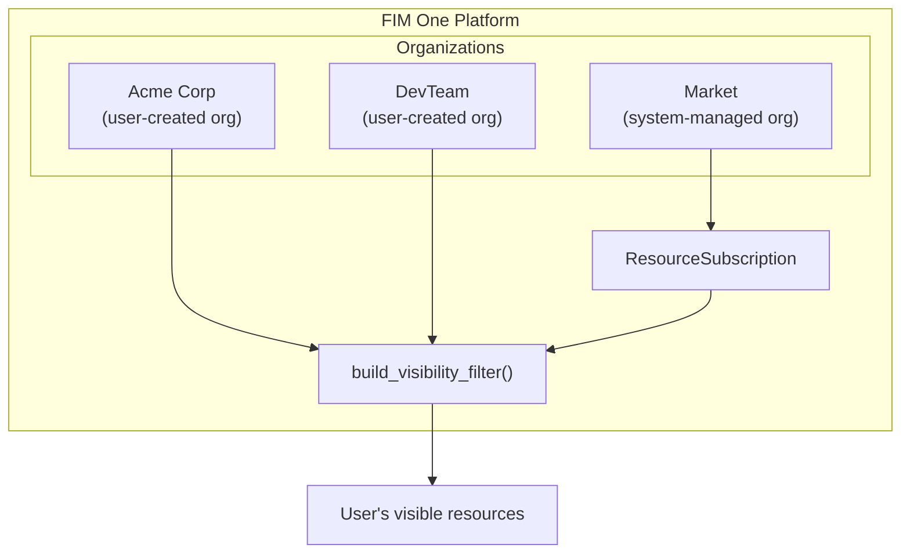
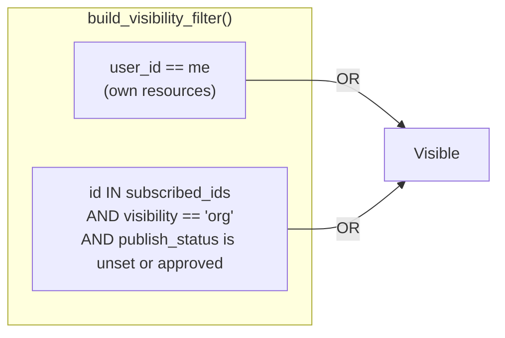
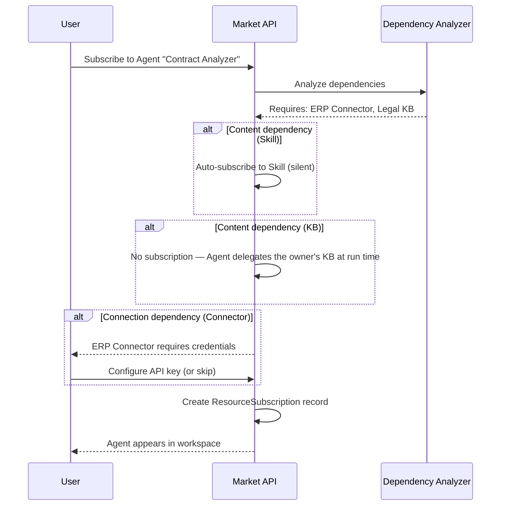
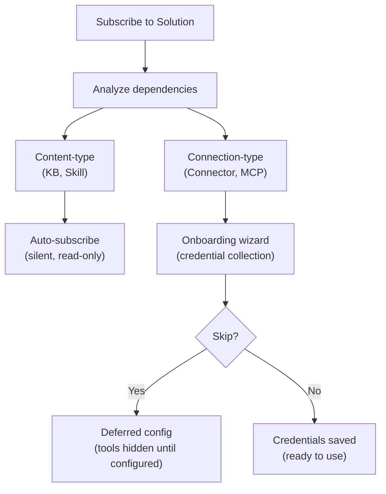

## 概述

Market 是 FIM One 的资源市场。用户发布他们构建的资源，其他人发现并订阅这些资源，订阅的资源会在订阅者的工作区中显示，就像是他们自己的资源一样。整个系统建立在一个单一的架构洞察上：**Market 是一个组织** — 一个系统管理的影子组织，具有特殊的信任规则。

本页面解释了 Market 的内部架构。有关发布和订阅的用户界面概述，请参阅 [Market（功能）](/concepts/market)。有关订阅资源如何加载到工具集中的信息，请参阅 [智能体和资源发现](/architecture/agent-discovery)。

## 两层分类

Market 根据资源的功能而非实现方式，将资源组织为两个类别。

### Solutions

Solutions are things that **do work for you**. A user subscribes to a Solution and gets a ready-to-use capability.

| Resource Type | What It Does |
|---|---|
| **Agent** | A conversational AI assistant with bound tools, knowledge, and instructions |
| **Skill** | A global SOP (Standard Operating Procedure) that can orchestrate multiple agents via `call_agent` |
| **Workflow** | A DAG-based automation flow with visual editing and deterministic execution |

Skills and Workflows are optional modules, off by default. While a module is off its resources are absent from the Market and cannot be subscribed to.

Solutions may depend on other resources. An Agent might require a specific Connector for its API calls and a Knowledge Base for its retrieval pipeline. The Market handles these dependencies automatically during subscription (see [Dependency resolution](#dependency-resolution) below).

### Components

Components are **reusable building blocks** for developers. They provide capabilities that Solutions consume.

| Resource Type | What It Does |
|---|---|
| **Connector** | An API integration adapter definition (database connectors cannot be published) |
| **MCP Server** | A tool service configuration using the Model Context Protocol |

Components are simpler to subscribe to — they have no internal dependencies, only credential requirements.

### 为什么知识库不单独列出

知识库根本不可共享——既不在市场中共享，也不与组织共享。知识库只能作为共享智能体的内部依赖项被其他用户访问：在运行时，智能体委托所有者的内容，因此订阅者永远不会持有知识库订阅，也不需要单独查找、评估或管理知识库。

<Info>
两层分类（解决方案与组件）是一个**显示层概念**。它在查询时从`resource_type`派生，而不是作为单独的字段存储。底层订阅机制、可见性过滤和审查流程对所有资源类型都是相同的。
</Info>

## 统一架构

### 市场作为影子组织

市场最重要的架构决策是它不是一个单独的子系统。它是一个**组织** — 一个系统管理的组织，具有固定的ID（`MARKET_ORG_ID`），在平台初始化期间自动创建。

这意味着：

- **相同的可见性过滤器**（`build_visibility_filter()`）在单个查询中处理个人、组织和市场资源。没有市场查询的特殊情况代码。
- **相同的订阅机制**（`ResourceSubscription`）适用于组织和市场资源。订阅组织资源和订阅市场资源会创建相同的记录。
- **相同的凭证处理**（回退、每用户覆盖）在两种上下文中都有效。连接器和MCP服务器上的`allow_fallback`标志的行为完全相同，无论来源如何。
- **相同的审查流程**（`apply_publish_status()`）处理组织级别和市场级别的审查。唯一的区别是市场组织将所有审查标志锁定为`true`。

常规组织和市场组织之间的关键区别：

| 方面 | 组织 | 市场 |
|---|---|---|
| **信任模型** | 高信任（团队成员） | 不假设信任（全球社区） |
| **审查** | 每种资源类型可选 | 始终对所有类型强制 |
| **访问** | 对所有成员自动 | 需要显式订阅 |
| **范围** | 团队或公司 | 全球 |

<Tip>
因为市场只是一个具有特殊规则的组织，为组织构建的任何功能 — 审查工作流、凭证管理、资源生命周期 — 自动适用于市场，无需任何额外实现。
</Tip>

### How the visibility filter handles it

Nobody holds membership in the Market org. Users do not "join" the Market — they subscribe to individual resources. This means `MARKET_ORG_ID` is never present in a user's `user_org_ids` list, and the org-membership visibility condition is naturally skipped for Market resources.

Instead, subscribed Market resources flow through the `subscribed_ids` path in `build_visibility_filter()`, the same path org-shared resources take:

This two-condition OR clause is the entire visibility model. Org membership alone grants nothing: org-shared and Market resources both reach a user through a subscription, and the share state is re-read on every query, so a subscription stops working as soon as the owner unpublishes the resource or it is awaiting or refused by review.

### 基于范围的浏览

Market 页面提供了一个**范围选择器**，可在两个浏览上下文之间切换：

| 范围 | 显示内容 | 审核人员 |
|---|---|---|
| **全局 Market** | 由任何人发布到 Market 组织的资源 | 平台管理员 |
| **组织：[name]** | 由特定组织成员发布的资源 | 组织管理员 |

两个范围中应用相同的 UI、相同的选项卡（Solutions / Components）和相同的订阅流程。切换范围只会改变浏览查询中的 `org_id` 过滤器。从用户的角度来看，体验是相同的——他们正在浏览目录并选择要安装的内容。

## 订阅流程

### 浏览和发现

用户通过分页目录浏览市场。每个资源显示其名称、描述、图标、发布者用户名和订阅按钮。用户已订阅的资源会相应标记。浏览 API（`GET /api/market`）排除用户自己的资源 — 您无法订阅您发布的内容。

### 订阅解决方案

订阅解决方案（智能体、技能或工作流）涉及依赖分析：

1. 系统分析解决方案的依赖——它需要哪些连接器、知识库、MCP 服务器和技能。
2. **内容类型依赖**无需询问用户即可处理。技能会自动静默订阅。知识库永远不会被订阅——智能体在运行时委托其所有者的知识库，因此订阅者无需配置任何内容。
3. **连接类型依赖**（连接器、MCP 服务器）被列为需求。入职向导收集凭证。
4. 创建`ResourceSubscription`记录，资源出现在用户的可见性筛选器中。

### 订阅组件

组件（连接器和 MCP 服务器）的流程更简单——不需要进行依赖分析。用户订阅、可选地配置凭证，组件就可以使用了。

### Credential configuration

Credentials follow a **hybrid model** that balances convenience with flexibility:

- **Offered during subscription.** When a connection-type dependency requires credentials, the onboarding wizard presents the credential form immediately.
- **Skippable.** The user can choose "Skip, configure later." The resource is subscribed, but the tools that need those credentials stay out of the agent's toolset until the user configures them (or the publisher allows fallback).
- **Deferred configuration.** Users can configure or update credentials at any time from their settings page.

This is the same `allow_fallback` mechanism used in organizations. If the publisher has enabled fallback and set a default credential, subscribers can use the resource immediately without providing their own key. If fallback is disabled, each subscriber must bring their own.

<Warning>
When using a Market resource with credential fallback enabled, your API requests flow through the publisher's credentials. For sensitive operations, consider providing your own credentials or verifying the publisher's trustworthiness.
</Warning>

### Unsubscribing

Unsubscribing removes the `ResourceSubscription` record. The resource disappears from the user's visibility filter and is no longer loaded into tool sets. For Solutions, dependencies that were subscribed automatically (Skills, Connectors, MCP Servers) are removed as well when no other subscribed Solution needs them, along with the credentials saved for those Connectors and MCP Servers. Unsubscribing from a Connector or MCP Server directly removes the user's credential for it.

## 依赖项解析

当发布或订阅解决方案时，系统会分析其依赖树。依赖项分为两个类别，具有不同的处理策略。

### 内容类型依赖

**知识库**和**技能**是解决方案引用的内容类型依赖。它们提供只读数据——检索文档、标准操作流程——供解决方案使用。

- **技能——按订阅：** 自动静默订阅。用户看不到单独的订阅步骤。
- **知识库：** 从不订阅。绑定的知识库在运行时由所有者智能体委派（所有者委派），因此订阅者一侧无需配置或清理。
- **访问模型：** 对原作者资源的只读引用。订阅者无法修改内容。
- **取消订阅时：** 当父解决方案被取消订阅时，自动订阅的依赖会自动清理。

### Connection-type dependencies

**Connectors** and **MCP Servers** referenced by a Solution are connection-type dependencies. They require credentials to function.

- **On subscription:** subscribed together with the Solution and listed as requirements in the onboarding wizard. The user is prompted to configure credentials (or skip).
- **On unsubscription:** a Connector or MCP Server that was subscribed automatically with the Solution is removed with it, credentials included, unless another subscribed Solution still needs it. One the user subscribed to on their own is left in place with its credentials.

## 发布

### 发布解决方案

当作者将智能体、技能或工作流发布到市场时：

1. 系统在资源上设置 `visibility: "org"` 和 `org_id: MARKET_ORG_ID`。
2. 系统分析解决方案的依赖项并构建清单 — 列出所需的连接器、知识库和 MCP 服务器。
3. 清单显示给作者以供确认。
4. `apply_publish_status()` 将资源设置为 `pending_review`（市场组织的所有审查标志都锁定为 `true`）。
5. 系统管理员审查并批准或拒绝该资源。

### 发布组件

发布连接器或 MCP 服务器更简单：

1. 系统如上所述设置可见性和 org_id。
2. 提取凭证架构（订阅者需要填写的字段）。
3. 资源进入 `pending_review` 并等待管理员批准。

### 审核流程

审核流程是组织使用的相同机制，但有一个关键区别：

| 上下文 | 需要审核？ | 谁进行审核 |
|---|---|---|
| **组织** | 可按资源类型配置（`review_agents`、`review_connectors` 等） | 组织管理员 |
| **市场** | 对所有资源类型始终必需 | 平台管理员（市场组织所有者） |

市场组织初始化时所有六个审核标志都设置为 `true`，此配置无法更改。发布到市场的每个资源必须通过管理员审核才能在浏览目录中可见。

<Note>
组织所有者自动绕过审核 — 他们发布的资源立即可用。对于市场，只有市场组织所有者（系统管理员）具有此绕过权限。
</Note>

当已批准的资源由其作者编辑时，`check_edit_revert()` 会自动将 `publish_status` 恢复为 `pending_review`。这确保对实时市场资源的更改在对订阅者可见之前会重新接受审核。

## 实现说明

### The shadow org

The Market organization has a well-known fixed ID (`00000000-0000-0000-0000-000000000001`) and slug (`market`). It is created by `ensure_market_org()` during platform initialization, when the first user (the administrator) registers. The function is idempotent; calling it multiple times is safe.

### ResourceSubscription

`ResourceSubscription` 表是市场访问的核心数据结构：

| 列 | 用途 |
|---|---|
| `user_id` | 订阅者 |
| `resource_type` | `agent`、`connector`、`mcp_server`、`skill` 或 `workflow`（知识库永远不会被订阅——它们通过智能体所有者委派方式运作） |
| `resource_id` | 被订阅资源的ID |
| `org_id` | 源组织（市场组织ID或常规组织ID） |

`(user_id, resource_type, resource_id)` 上的唯一约束防止重复订阅。`org_id` 列跟踪订阅的来源，启用范围感知的取消订阅。

### Visibility filter integration

The `resolve_visibility()` function performs two lookups in a single call:

1. Fetches the user's org memberships (`user_org_ids`)
2. Fetches the user's subscriptions (`subscribed_ids`)

These are passed to `build_visibility_filter()`, which produces a single SQL WHERE clause combining the two visibility conditions (own, or subscribed and still shared). This function is used everywhere resources are queried — agent lists, connector dropdowns, skill injection, auto-discovery mode — ensuring consistent visibility across the entire platform.

### 凭证加密

在订阅期间（或稍后在设置中）配置的凭证使用平台的加密密钥进行静态加密。Market API 在浏览响应中从不公开凭证值 — 只有元数据（名称、描述、图标、类型）在 `_*_market_info()` 辅助函数中返回。

## 另见

- [组织与市场](/architecture/organization) -- 组织级别的共享和信任模型
- [智能体与资源发现](/architecture/agent-discovery) -- 订阅的资源如何加载到工具集中
- [连接器架构](/architecture/connector-architecture) -- 连接器设计、身份验证注入和审计
- [系统概览](/architecture/system-overview) -- 所有资源汇聚的统一工具抽象
