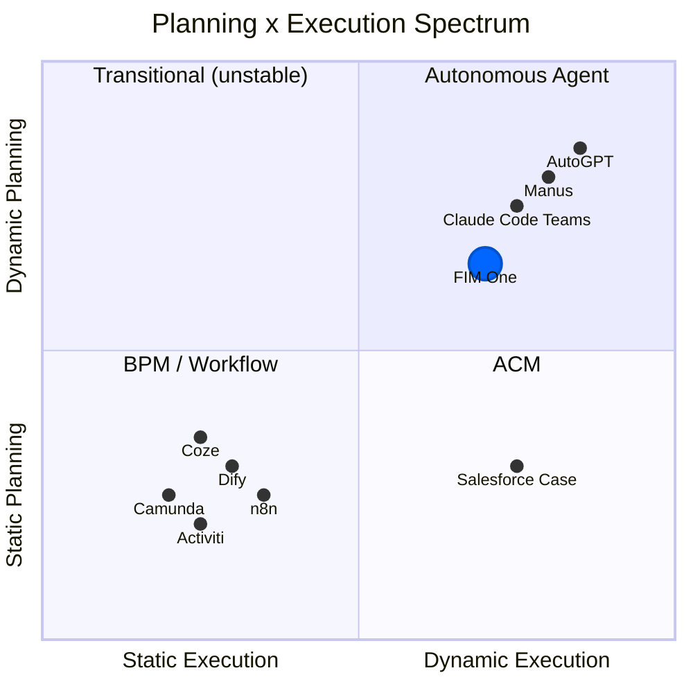
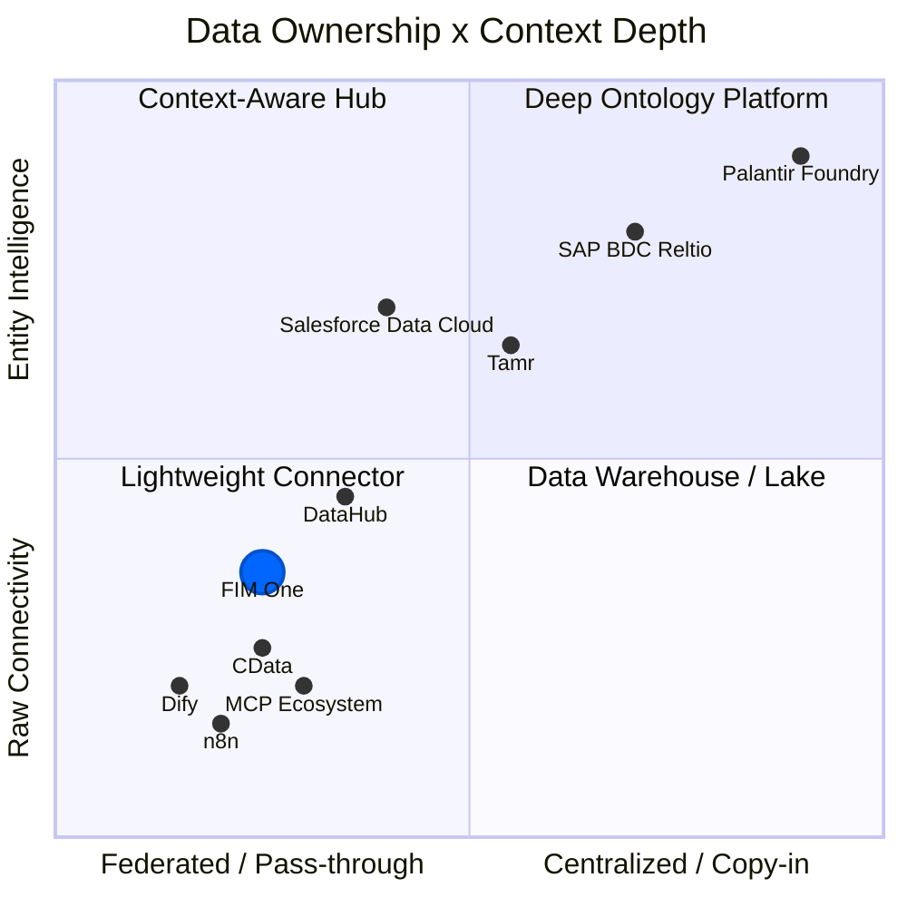

## 为什么动态规划是困难的中间地带

AI 智能体的格局分为两个阵营，两者都选择了简单的路径。传统工作流引擎——Dify、n8n、Coze——选择了静态编排：带有固定执行路径的可视化拖放流程图。这不是无知；企业客户要求确定性（相同输入、稳定输出），而静态图能够提供这一点。在另一个极端，完全自主的智能体（AutoGPT 及其衍生品）承诺端到端的自主性，但被证明不切实际：任务分解不可靠、代币成本失控，以及无人能预测或调试的行为。

最佳点很窄但真实存在。简单任务不需要规划器。足够复杂需要数十个相互依赖步骤的任务会让当前的 LLM 不堪重负。但在两者之间存在一类丰富的问题——具有清晰的并行子任务的任务，这些任务很难硬编码，但对 LLM 来说可以分解。动态 DAG 规划正是针对这个区域：模型在运行时提出执行图，框架验证结构并以最大并发性运行它。没有拖放，没有盲目自主。

## 对改进模型的押注

每隔几个月基础就会发生变化——GPT-4、函数调用、Claude 3、MCP 协议。在不断变化的基础上构建严格的抽象是有风险的；LangChain 的过度抽象是这个领域中每个人都已经吸取的教训。FIM One 采取相反的方法：**最小化抽象，最大化可扩展性**。该框架拥有编排、并发和可观测性。智能来自模型，而模型不断改进。

今天，LLM 任务分解精度对于非平凡目标来说约为 70-80%。当达到 90% 以上时，动态规划的"最佳点"会大幅扩展——昨天过于复杂的问题明天就会变得易于处理。FIM One 的 DAG 框架旨在捕获这种扩展的价值，而无需重写底层逻辑。

## Will ReAct and DAG planning become obsolete?

ReAct will not disappear -- it will sink into the model. Consider the analogy: you do not hand-write TCP handshakes, but TCP did not go away; it got absorbed into the operating system. When models are strong enough, the think-act-observe loop becomes implicit behavior inside the model, not explicit framework code. This is already happening: Claude Code is essentially a ReAct agent where the loop is driven by the model itself, not by an external harness.

DAG planning's lasting value is not "helping dumb models decompose tasks" -- it is **concurrent scheduling**. Even with infinitely capable models, physics imposes latency: a serial chain of 10 LLM calls takes 10x longer than 3 parallel waves. DAG is an engineering problem (how to run things fast and reliably), not an intelligence problem (how to decide what to run). Retry logic, cost control, timeout management, observability -- these do not go away when models get smarter.

The endgame: **models own the "what" (planning intelligence internalizes into the model), frameworks own the "how" (concurrency, retry, monitoring, cost governance)**. A framework's lasting value is not intelligence -- it is governance.

This is the sentence the rest of FIM One is downstream of. Once the model owns the "what," durable value moves to governing the "how" -- and the highest-value "how" in any enterprise is *reach* into the systems that refuse to talk to each other. The integration layer is one inferential step from here, and the history shows it: the project began as a DAG orchestration framework (`fim-agent`) and became a connector platform within a single week -- not through a rewrite, but because this bet already required it.

## Why not mirror Dify's workflow editor

A natural question: if DAG covers the flexible case, shouldn't we also build a static workflow editor for the deterministic case?

Not as the core. FIM One does ship a visual Workflow editor (9 node types, cron and API triggers), but as an optional module that is off by default. The reasoning for keeping it secondary:

1. **The workflows already exist elsewhere.** Government and enterprise clients' fixed processes live in their OA, ERP, and legacy systems. They don't want to rebuild those flows in yet another platform -- they want AI that can connect to the systems where those flows already run. The Connector Platform (v0.6) solves this directly.

2. **Existing capabilities compose into fixed pipelines.** Scheduled Jobs (v1.0) trigger a DAG agent with a fixed prompt; the DAG dynamically plans the steps; Connectors (v0.6) connect to the target systems. The combination is equivalent to a static pipeline -- but more flexible, because the LLM can adjust its plan based on the data it encounters. No separate pipeline DSL needed.

3. **Investment mismatch.** A production-quality visual workflow editor (canvas, node types, variable passing, debug/replay) is months of dedicated effort. The result would be a low-fidelity copy of what Dify's 120K-star community already maintains. That effort is better spent on the Connector architecture -- a capability no competitor offers.

The strategic bet: **don't compete on workflow visualization; compete on being the agent platform where systems meet AI**. Let Dify own "build AI workflows visually." FIM One owns "the all-in-one agent platform for Global × China enterprises."

## Where FIM One stands

FIM One is not an "AGI task scheduler" and not primarily a static workflow engine. It occupies the middle ground: planning capability with constraints, concurrency with observability.

- Compared to **Dify**: more flexible -- runtime DAG generation vs. design-time flowcharts. You do not need to anticipate every execution path in advance. Does not compete on visual workflow editing; competes on legacy system integration.
- Compared to **AutoGPT**: more controlled -- bounded iterations, re-planning limits, with human confirmation gates. Autonomy within guardrails.

The strategy is straightforward: build the orchestration framework now, and let improving models fill it with capability over time.

## Where FIM One Sits: Planning x Execution Spectrum

The AI execution landscape can be mapped on two axes -- how plans are created (static vs dynamic) and how they are executed (rigid vs adaptive):

**Why Dify/n8n are Static Planning + Static Execution**: The DAG is drawn by a human on a visual canvas at design time. Each node executes a fixed operation (an LLM call with a fixed prompt, an HTTP request, a code block). There is no runtime replanning -- if a step fails, the workflow fails or follows a pre-wired error branch. This is structurally the same as BPM, just with AI nodes in the graph.

**FIM One's position: Dynamic Planning + Dynamic Execution**

- **DAG topology is generated by LLM at runtime** (dynamic planning) -- no human designs the graph
- **Each DAG node runs a full ReAct loop** (dynamic execution) -- nodes reason, use tools, and adapt
- **Re-planning mechanism** (execute → analyze → re-plan if unsatisfied)
- But bounded: max 3 rounds in total (the first plan plus 2 re-plans), token budgets, human confirmation gates

This places FIM One in the same quadrant as AutoGPT, but with engineering constraints that prevent runaway behavior. More flexible than BPM/Dify, more controlled than AutoGPT.

## Concept Glossary

For readers unfamiliar with the terminology used in this document:

| Term | One-line explanation | Relation to FIM One |
|------|---------------------|----------------------|
| **BPM** (Business Process Management) | Processes fully fixed at design time, executed rigidly. Camunda, Activiti. | FIM One is **not** BPM. Fixed processes are covered by the optional Workflow module, not the core. |
| **FSM** (Finite State Machine) | System is in exactly one state at any time; events trigger transitions. Supports loops (reject → resubmit). | Target systems (ERP, contract systems) use FSM internally. FIM One **doesn't need** its own FSM -- it calls the target system's API. |
| **ACM** (Adaptive Case Management) | Skeleton static, branches dynamic. Main flow pre-defined, each node adapts at runtime. | FIM One's DAG + ReAct naturally falls in this quadrant. |
| **HTN** (Hierarchical Task Network) | Recursive task decomposition: high-level → subtasks → atomic operations. | DAG re-planning covers most scenarios; full HTN not needed yet. |
| **iPaaS** (Integration Platform as a Service) | Cloud integration platform connecting multiple SaaS/on-prem systems. MuleSoft, Zapier. | FIM One's integration layer is like **AI-native iPaaS** -- natural language drives cross-system integration. |
| **MDM** (Master Data Management) | Deduplicates and unifies entity records across systems into a "golden record." Reltio, Informatica, Tamr. | FIM One **connects to** MDM systems; it does not replicate entity resolution. |
| **Context Layer / System of Context** | Unified entity + relationship graph that gives AI agents trusted business context. Term popularized by Reltio (2026). | FIM One delegates this to upstream MDM/data platforms. Skills provide lightweight aggregation for common cases. |

## 架构边界：FIM One 不复制工作流逻辑

复杂的业务流程（审批链、转移、拒绝、升级、共同签署、副署）是**目标系统的责任**。这些系统花费多年构建这些逻辑 -- ERP、OA、合同管理系统都拥有成熟的状态机。

从连接器的角度来看：

| 操作 | 连接器的作用 |
|-----------|------------------------|
| 转移 | 调用一个 API，传递目标人员 |
| 拒绝 | 调用一个 API，传递拒绝原因 |
| 升级 | 调用一个 API，传递升级人员列表 |
| 共同签署 | 调用一个 API，传递共同签署人列表 |

每个复杂的工作流操作都简化为一个带参数的 HTTP 请求。FIM One 调用 API；目标系统管理状态机。

这是一个**刻意的架构边界**，而不是能力缺陷。复制目标系统中已存在的工作流逻辑会：
1. 增加维护负担（两个状态机需要保持同步）
2. 增加故障模式（如果它们不一致怎么办？）
3. 提供零附加价值（目标系统已经正确处理了这一点）

连接器模式设计简洁：**一个操作 = 一个 API 调用**。

## 架构边界：连接器层，而非上下文层

企业 AI 正在采用分层架构来管理智能体上下文：

| 层 | 功能 | 代表性产品 |
|-------|-------------|----------------------|
| **决策追踪** | 记录*为什么*发生了某事 -- 审计追踪、血缘关系 | Palantir Decision Lineage、Arize |
| **实体上下文** | 统一的黄金记录 + 关系图 -- "上下文系统" | Reltio/SAP、Informatica/Salesforce、Tamr |
| **数据连接** | 通过 API 和协议将智能体连接到源系统 | **FIM One**、CData、MCP 生态系统 |
| **源系统** | CRM、ERP、合同管理、数据库、SaaS 应用 | SAP、Salesforce、自定义系统 |

FIM One 在**数据连接层**运行。它不尝试构建其上方的实体上下文层。这是一个有意的选择，而不是一个缺陷。

### 行业背景：2025-2026年整合浪潮

两项标志性收购重塑了企业AI数据格局，并使上下文层成为战略竞争地：

- **Salesforce收购Informatica**（2025年11月）-- 将企业MDM和数据治理能力添加到其Data Cloud + Agentforce堆栈中。目标：通过将Agentforce智能体建立在Informatica的黄金记录基础上，使其值得信赖。
- **SAP宣布收购Reltio**（2026年3月）-- 将AI原生实体解析和关系图添加到其业务数据云（BDC）中。目标：创建跨越SAP和非SAP环境的"上下文系统"，作为Joule智能体的可信基础。

这些举措表明，全球最大的企业平台现在认为统一的实体上下文是可靠AI智能体的先决条件 -- 而不仅仅是锦上添花。

### 数据所有权 × 上下文深度光谱

**图表解读：**

- **左下（轻量级连接器）**：数据所有权最少，仅提供原始 API 连接能力。Dify、n8n 和基础 MCP 服务器位于此处——它们可以连接系统，但不了解实体。FIM One 也位于这一象限，但由于渐进式披露元工具、基于 Skill 的上下文聚合以及具备领域感知能力的升级机制，在 y 轴上的位置更高。
- **左上（上下文感知中枢）**：提供联合访问能力，并具备实体级理解。Salesforce Data Cloud 是这一模式的典型代表——通过按需实体解析实现零拷贝联合。DataHub 提供元数据级上下文（架构、血缘、所有权），但不拥有业务数据。
- **右上（深度本体平台）**：完整摄取数据，并具备深度实体智能。SAP BDC + Reltio 构建持久化的多领域黄金记录及关系图谱。Palantir 走得最远——采用三层本体，并提供决策血缘。
- **右下（数据仓库／湖）**：集中式数据存储，但缺乏实体语义。传统数据平台会摄取所有数据，却缺少实体解析或关系建模能力。

FIM One 所处的位置体现了一项经过审慎考虑的选择：保持联合式和轻量级，同时投入资源，让智能体能够轻松访问上游实体上下文（来自任何 MDM）。

### 三种实体上下文模型

**SAP：多域黄金记录（复制入库 + 治理）**

SAP 正在构建三层企业架构：

| 层级 | 系统 | 角色 |
|-------|--------|------|
| **交易** | S/4HANA | 业务执行 -- 订单、发票、交付 |
| **智能** | Business Data Cloud (BDC) + Reltio | 语义集成、实体解析、关系图 |
| **智能体** | Joule + Joule Agents | 意图理解、工具编排、自主执行 |

Reltio 位于智能层的核心。其职责：从 SAP 和非 SAP 系统摄取实体数据，通过基于 AI 的匹配解决重复项，并生成**多域黄金记录**（客户、供应商、产品、患者、资产）以及关系图。Reltio 对 **MCP 协议**的早期采用在战略上意义重大 -- 它将黄金记录定位为任何 MCP 兼容智能体都可直接调用的资源，而不仅限于 SAP 自己的 Joule。

SAP 的赌注：智能体需要一个持久的、受治理的、跨域的"唯一真实来源"来在高风险企业流程中可靠地运作。

**Salesforce：零复制联邦（联邦 + 按需解析）**

Salesforce 采取了更轻量级的方法。Data Cloud 不需要物理数据移动；相反，它使用**零复制合作伙伴关系**（Databricks、Snowflake、BigQuery）来就地联邦数据。实体解析在 Data Cloud 内按需进行，创建统一的客户档案，无需持久的黄金记录存储。

关键数据（2026 财年第三季度）：Data Cloud 摄取了 32 万亿条记录，其中 15 万亿条通过零复制（同比增长 341%）。这个规模验证了联邦模型对于以 CRM 为中心的用例的有效性。

Agentforce 智能体基于这种联邦上下文：它们在分布式数据资产中推理，无需所有数据都落地到一个系统中。对于前台场景（销售、服务、营销），这既灵活又快速部署。

Salesforce 的赌注：智能体不需要重量级的黄金记录存储 -- 它们需要实时访问联邦的、已解析的上下文，就在数据已存在的地方。

**Palantir：深层本体（重量级参考）**

在极端情况下，Palantir Foundry 摄取所有数据并构建三层本体（语义对象 + 动力学操作 + 动态规则），具有完整的决策谱系。这是生产中最完整的上下文系统，但合同价格为 1000 万美元以上，部署周期为 6-18 个月。它充当参考架构，而不是大多数组织的现实模型。

### FIM One 的定位

| 维度 | SAP + Reltio | Salesforce + Informatica | FIM One |
|-----------|-------------|-------------------------|---------|
| **数据理念** | 复制导入：导入到 BDC，构建黄金记录 | 联邦化：零复制访问，按需解析 | 直通：连接到源，不存储 |
| **实体解析** | 深度 -- AI 原生 MDM 与关系图 | 中等 -- Data Cloud 实体解析 | 无 -- 委托给上游 MDM |
| **智能体集成** | Joule 智能体 + MCP | Agentforce + Data Cloud 基础 | 任何智能体 + 任何连接器 |
| **部署成本** | 企业平台定价 | 企业 SaaS 定价 | 轻量级，数小时到数天 |
| **锁定** | 高（BDC + S/4HANA 生态系统） | 中等（Salesforce 生态系统） | 低 -- 连接器可互换 |
| **最佳适用场景** | 制造、供应链、生命科学（复杂多域） | CRM 驱动型企业（前台办公重点） | 中端市场、多系统、供应商无关 |

FIM One 最接近 **Salesforce 理念**（不拥有数据，连接到数据），但不依赖 Salesforce 生态系统。战略定位：在连接层保持供应商无关性，让任何 MDM -- 无论是 SAP/Reltio、Salesforce/Informatica、Tamr 或自定义解决方案 -- 充当实体上下文源。

### 为什么 FIM One 保持在连接器层

构建实体上下文层需要持久数据存储、基于机器学习的实体解析、存活规则、关系图引擎和治理框架。这是一个独特的产品类别 (MDM)，具有十年深度的竞争 (Reltio、Informatica、Tamr)。尝试这样做会：

1. **将 FIM One 从连接器转变为数据平台** -- 从根本上不同的产品、团队和市场进入方式
2. **复制上游系统已经提供的功能** -- 我们在工作流逻辑中避免的相同反模式
3. **增加锁定** -- 一旦用户在 FIM One 中存储黄金记录，转换成本会急剧上升

正确的策略：**成为任何 MDM 系统的最佳入口点**，而不是其替代品。FIM One 应该使 Reltio、Informatica、Tamr 或自定义 MDM 为智能体提供实体上下文变得轻而易举 -- 通过 MCP Resources、连接器 API 或知识库注入。

### 当前方法：技能作为轻量级上下文聚合

对于需要跨连接器上下文的场景（例如，合同审查需要供应商数据 + 付款历史 + 风险标志），**技能**已经提供了一个实用的解决方案。技能的 SOP 可以按顺序编排多个连接器操作，聚合结果，并向智能体呈现结构化上下文 -- 无需构建持久实体层。

这涵盖了 80% 的用例。如果未来出现对连接器级别实时实体解析的需求，该架构为未来的 `ContextSource` 连接器类型留出了空间，该类型可与外部 MDM 系统集成 -- 但这是未来的考虑，而非当前的承诺。

### 类比

FIM One 与上下文层的关系就像 SQLAlchemy 与数据库的关系：它不存储或管理数据，但它使任何数据源都可以被应用层访问。让 MDM 平台拥有实体解析；让 FIM One 拥有连接。

## FIM One 在 AI 堆栈中的位置

### The Layered Model

A useful mental model (credit [Phil Schmid](https://www.philschmid.de/)) maps AI systems to a four-layer stack analogous to computing hardware:

| Layer | Analogy | FIM One Component |
|-------|---------|-------------------|
| **Model** | CPU | ModelRegistry -- any OpenAI-compatible LLM |
| **Context** | RAM | ContextGuard + Memory (Window / Summary / DB) |
| **Harness** | Operating System | ReAct Agent + DAG Planner + Hooks + ToolRegistry |
| **Application** | App | Portal, API |

FIM One operates at the **harness layer** -- it does not compete with models; it makes them productive by providing the right tools, constraints, and feedback loops. The model supplies intelligence; the harness supplies governance, concurrency, and reliability.

### Three Eras of AI Engineering

The discipline has evolved through distinct phases: **Prompt Engineering** focused on crafting better instructions to elicit correct behavior from a fixed model. **Context Engineering** shifted attention to assembling the right information -- retrieving documents, injecting tool results, managing memory -- so the model has what it needs to reason well. **Harness Engineering** goes further: designing the full execution environment around the model, including deterministic guardrails, tool orchestration, feedback loops, and cost controls.

FIM One's architecture embodies harness engineering principles. The [Hook System](/architecture/hook-system) runs platform code outside the LLM loop at well-defined lifecycle points — today `ApprovalGateHook` intercepts sensitive tool calls and routes approval to an in-portal card or an IM channel, and the same abstraction can carry audit logging, read-only-mode enforcement, rate limits, and result truncation if those are ever needed. ContextGuard manages what enters the context window and when. Dynamic tool selection (progressive-disclosure meta-tools) keeps the tool surface tractable as connector count grows. The ReAct loop's self-reflection mechanism and the DAG planner's re-plan cycle provide structured feedback that improves execution quality without requiring a more capable model.
