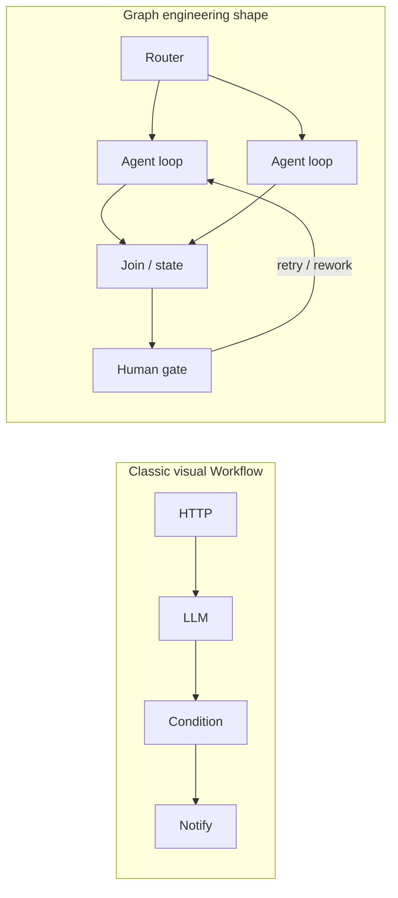
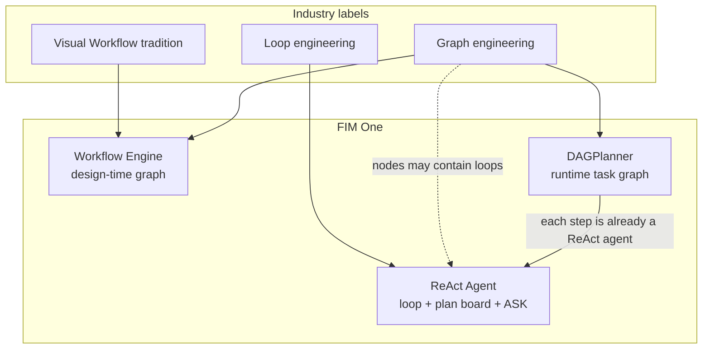
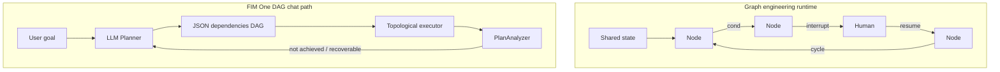
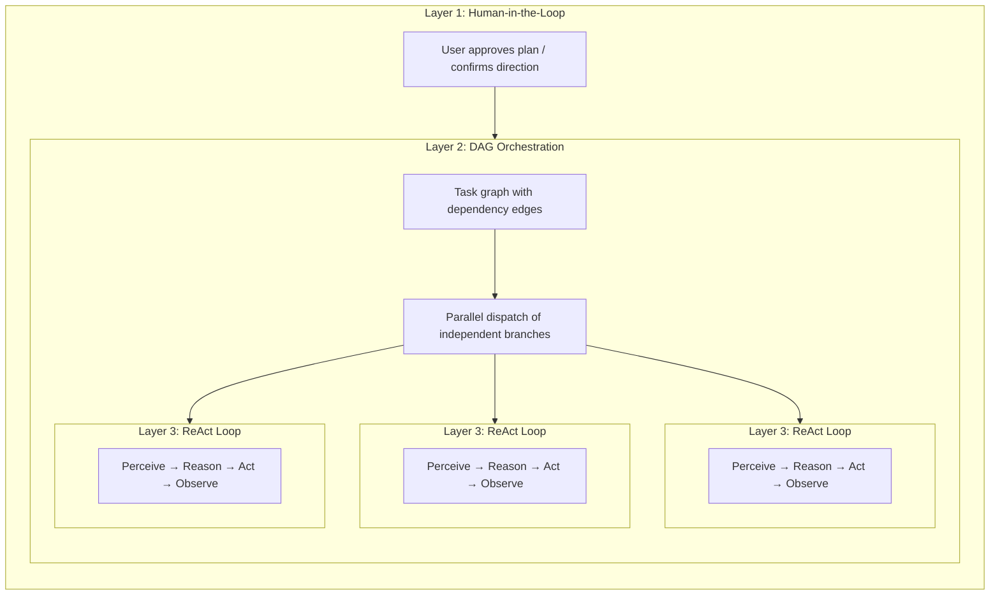

## 图工程（2026）与 FIM One

业界讨论中常见一种转变——从**循环工程**（单个智能体反复思考和行动）转向**图工程**（将多节点拓扑作为显式工程对象）。这个标签很新，但实践由来已久。LangGraph 风格的系统和多智能体组织已经使用图多年了。对 FIM One 而言，重要的是人们所说的**是哪种**图，以及它如何映射到我们的三个执行层。

### What graph engineering usually means

| Layer (common framing) | Concern |
|---|---|
| **Harness** | Tools, sandbox, auth, logging, quotas around the model |
| **Loop** | One agent's think → act → observe cycle |
| **Graph** | How **nodes** connect: branches, joins, cycles, human checkpoints, shared state |

Consensus across that framing: **graph does not replace loop**. Graph designs **relationships between processes**; each agentic node may still run a full loop.

"Graph" is overloaded in practice. Three usages get mixed:

| Usage | Example | Role |
|---|---|---|
| **Control-flow graph** | LangGraph `StateGraph`: conditional edges, retries, interrupt/resume | State machine for who runs next |
| **Task dependency graph** | Claude Code Tasks `blockedBy`; FIM One `dependencies` | Schedule and parallelize work |
| **Knowledge graph** | Entities and typed relations | Retrieval / memory (not orchestration) |

This page is about the first two (orchestration).

### 不是"换了个名字的 Dify Workflow"

Dify 风格的**可视化工作流**和图工程共享血缘关系（**显式拓扑**），但它们不是同一个产品。

| | 经典可视化工作流（如 Dify） | 图工程（2026 用法） |
|---|---|---|
| **主要产物** | 实现者绘制的画布/蓝图 | 拓扑作为版本化系统设计（代码或配置） |
| **节点** | 固定能力块（LLM、HTTP、知识库、条件…） | **异构的**：函数、路由器、**完整智能体**、人类、连接 |
| **智能所在位置** | 主要在隔离的 LLM 节点内；图是一条管道 | 通常**在节点内**（每个可能是一个循环）；图组织角色 |
| **边** | 管道成功/失败和分支 | 控制流**和**状态转移，包括**受控循环** |
| **人在回路中** | 表单/审批作为附加功能 | 中断/恢复作为一等原语 |
| **与循环的关系** | 常被宣传为"工作流**vs**智能体" | 显式**图优于循环** |

简短形式：经典工作流是**确定性（或半确定性）管道**，偶尔有 LLM 步骤。图工程是**多节点系统拓扑**，其中关键位置仍然可以是自主智能体。

### How the industry map sits on FIM One

FIM One already spans the control spectrum; chat "Planner mode" is only one slice.

| Industry idea | Closest FIM One piece | Fit |
|---|---|---|
| Classic visual Workflow | **Workflow Engine** (design-time blueprint) | Strong |
| Control-flow graph + HITL + durable state | Workflow human steps + confirmation gates; partial on chat DAG | Medium |
| Task dependency graph + parallel schedule | **DAGPlanner** (`dependencies`, topological fan-out) | Strong on scheduling; weaker on mid-graph HITL |
| Single agent loop + checklist memory | **ReAct** (`update_plan`, tools, `ask_user_question`) | Strong |
| Runtime LLM-drawn plan every turn | **DAGPlanner** (not Dify; not LangGraph design-time DSL) | Distinct product |

### Graph engineering vs FIM One DAG (chat Planner)

Same family (explicit multi-step topology). Different species.

| Dimension | Graph engineering (typical) | FIM One DAG (chat) |
|---|---|---|
| **Who draws the graph** | Developer / implementer (stable topology) | **LLM at runtime** (new graph per goal) |
| **Edge meaning** | Often **control flow** (where next, including cycles) | Mostly **dependency / data** (`dependencies`, acyclic run) |
| **Correction** | Edge-level retry, human node, resume same graph | **PlanAnalyzer → replan** (often a **new** graph) |
| **Node depth** | Node may be a full agent loop | **Already full ReAct per step**: `DAGExecutor` runs `agent.run()` with a multi-iteration tool loop (default cap from `DAG_STEP_MAX_ITERATIONS`, commonly 15). Default model is registry **general** (not infrastructure fast); `model_hint` can escalate to reasoning or demote to fast. Tool cache, step/citation verification, and source evidence ship with each step. Step agents set `enable_plan_tool=False` (no `update_plan` board inside a step) because the unit of work is already a focused sub-task. |
| **Shared state** | First-class typed state + checkpoint narrative | Step results + memory/compact; step checkpoints exist |
| **Mid-run questions** | Interrupt as a product feature | Confirmation gates exist; **`ask_user_question` is ReAct-only** (chat outer loop), not a first-class DAG wait edge |
| **Product entry** | Framework or backend org chart | User-visible mode next to ReAct |

**Implication:** industry heat around graph engineering **validates keeping a graph/scheduling engine**. It does **not** require a chat default that forces users to pick "Planner" for every turn. Most tasks still want a strong loop; graphs earn their keep on parallel branches, fixed compliance paths, and multi-role orchestration.

### What FIM One can learn (empower ReAct, DAG, Workflow)

Concrete takeaways, not slogans. Ordered by leverage.

| # | Graph engineering idea | Apply to | Direction |
|---|---|---|---|
| 1 | **Graph over loop, not instead of** | Product + Auto routing | Default UX stays **ReAct** (loop + `update_plan` + `ask_user_question`). Use DAG/Workflow when topology earns cost. |
| 2 | **Heterogeneous deep nodes** | DAG | **Already the status quo.** Each step is a full ReAct agent (`agent.run`, multi-iteration tools, general-or-better model by default), not a one-shot LLM call. The one exception is a step the planner tags `llm_direct` (pure transformation of upstream outputs), which runs as a single tool-less call. Remaining knobs are optional (e.g. plan board on long steps), not a structural gap. |
| 3 | **Interrupt / resume as edges** | DAG + ReAct | Mid-run clarification belongs in the **outer** loop or as a first-class wait state. Avoid fake DAG steps that "ask the user" in text and then replan as "goal not achieved". |
| 4 | **Controlled cycles vs whole-graph replan** | DAG | Prefer step-local retry / partial carryover (already partly true for completed steps) over dumping all step text as a failed final answer. |
| 5 | **Typed shared state along edges** | DAG + Workflow | Stronger contracts for step I/O (schema, deliverables) reduce Analyzer false confidence and answer/source drift. |
| 6 | **Topology as a versioned asset** | Workflow | Keep human-authored graphs for audit; do not expect runtime LLM DAGs to replace compliance blueprints. |
| 7 | **Honest "most tasks never need a graph"** | Auto + docs | Route clarify-and-choose, short Q&A, and exploratory work to ReAct; reserve DAG for decomposable parallel work. |

**Anti-patterns to avoid when "doing graph":**

- Using a **dependency graph** to simulate a **human state machine** (multi-step "wait for answers" with no wait primitive).
- Equating ReAct **`update_plan`** (checklist memory) with graph engineering (scheduling topology).
- Shipping graph heat as a second chat personality instead of as **engine composition** (loop outside, schedule inside when needed).
- Describing FIM One DAG steps as "shallow LLM calls": that understates the engine and misleads product decisions.

## AI工具生态中的五种"规划"

"规划"这个词被过度使用了。当今至少存在五种不同的方法，它们解决的问题各不相同：

| 方法 | 规划格式 | 执行 | 审批 | 核心价值 |
|---|---|---|---|---|
| **隐式模型规划** | 内部思维链 | 单次推理 | 无 | 模型自主思考步骤 |
| **Claude Code规划模式** | Markdown文档 | 串行 | 人工在执行前审查 | 在修改代码前对方法达成共识 |
| **Claude Code Teams** | 带依赖边的任务列表 | **并发**（多智能体） | 人工审批规划，然后自主执行 | 动态智能体池+并行执行 |
| **Kiro规范驱动开发** | 结构化规范（需求+设计+任务） | 串行 | 人工审查规范 | 可追溯的需求、验收标准 |
| **FIM One DAG** | JSON依赖图 | **并发**（单个编排器） | 自动（PlanAnalyzer） | 并行执行+运行时调度 |

前两种是**设计时**规划——它们在工作开始前生成规划，人工（或模型本身）逐步执行。后三种引入了**运行时**规划——执行图由程序生成和调度，独立分支并行运行。区别在于*谁*执行：Claude Code Teams生成自主智能体；FIM One DAG在单个编排器内调度步骤。

这些方法不是竞争关系，而是互补层。Kiro风格的规范可以定义*构建什么*，而FIM One DAG可以并发调度*如何*执行子任务。Claude Code的规划模式确保人工同意该方法；FIM One的PlanAnalyzer自动验证结果。

## 三层嵌套：全功能架构

Claude Code Teams和FIM One DAG在满负荷运行时都展现出**三层嵌套架构**：

- **第1层——人工确认闸门**：用户审查计划并在执行开始前批准。
- **第2层——DAG编排**：批准的计划被分解为具有依赖边的任务。独立任务并行运行；下游任务等待其阻塞条件解决。
- **第3层——ReAct内循环**：每个任务由运行完整ReAct循环的智能体执行（感知→推理→行动→观察），支持多步推理、工具使用和自主重试。

关键洞察：**Claude Code Teams和FIM One DAG实现相同的三层结构，只是第2层机制不同**——消息传递vs依赖边解决。

## Full-Power Runtime: FIM One vs Claude Code Teams

Both are genuine Agents — the core loop is identical: **Perceive → Reason → Act → Feedback**. The difference lies in how they orchestrate parallel work at full capacity.

| Dimension | Claude Code Teams | FIM One DAG |
|---|---|---|
| **Parallel model** | Leader spawns SubAgents, assigns tasks via messages | Topological sort auto-parallelizes independent steps |
| **Task graph** | TaskList with `blockedBy` / `blocks` edges (dynamic DAG) | Static JSON DAG with `dependencies` edges |
| **Coordination** | Explicit message passing (SendMessage / Broadcast) | Implicit dependency edges — no messages, just data flow |
| **Agent lifecycle** | Dynamic pool — agents spawned on demand, shut down when done | Per-step **ReAct agents** (fresh agent per step via `_resolve_agent`); each step runs a full multi-iteration tool loop |
| **Feedback & correction** | Each SubAgent retries autonomously; Leader re-assigns on failure | PlanAnalyzer evaluates outcomes → Re-Planning loop (up to 3 rounds in total: the first plan plus 2 re-plans); completed steps can carry into the next plan |
| **Human involvement** | Plan mode approval, then autonomous execution | Fully automatic — PlanAnalyzer decides pass/replan (chat-level ASK is ReAct-only) |
| **Context management** | Each SubAgent gets isolated context window (no cross-contamination) | Shared DbMemory + LLM Compact across the turn; each step agent still sees its task + dependency results, not a full peer transcript |
| **Token economics** | `N agents × per-agent tokens` — time↓ tokens↑ (multiplicative cost) | Parallel branches cost more than serial ReAct, but shared memory and step caps usually stay below multi-agent team spend |
| **Scaling pattern** | Add more SubAgents (horizontal, message-coupled) | Add more DAG branches (horizontal, dependency-coupled) |
| **Best suited for** | Diverse, loosely-related tasks (research + code + test) | Structured workflows with clear data dependencies |

### 真实基准测试：v0.5 RAG 系统

Claude Code Teams 在单个会话中构建了 FIM One 的整个 v0.5 RAG 子系统：

- **8 个阶段**：嵌入 → 重排序器 → 加载器 → 分块 → 向量存储 → 检索 → 知识库后端 → 前端 + 文档
- **46 个测试**通过，前端构建清晰
- **墙钟时间**：约 5 分钟
- **令牌成本**：每个智能体任务约 100k 令牌 × 8+ 个任务 ≈ 800k+ 总令牌
- **依赖边**：第 5 阶段依赖第 4 阶段 + 1b；第 6 阶段依赖第 5 阶段 + 2 + 3——一个真正的 DAG

这演示了核心权衡：**以令牌倍增为代价的时间并行性**。Claude Code Teams 用计算成本换取开发者时间。

### 汇聚而非竞争

"团队协作"和"管道调度"之间的界限正在模糊：

- **Claude Code Teams 的 `blockedBy`/`blocks` 本质上就是一个 DAG** — 任务具有显式的依赖边，领导者在前置任务完成时分派新解锁的任务。这是拓扑调度加上额外步骤（消息）。
- **FIM One DAG 步骤已经是完整的 ReAct 智能体** — 第 3 层不是愿景。每个步骤都运行带有工具和多迭代循环的 `agent.run()`；与顶层 ReAct 聊天轮次的差异是有意的（无每步计划板、无聊天级 `ask_user_question` 等待、由 `model_hint` / 通用默认值选择模型）。

**要点：** 相同的智能体本质，汇聚的平行理念。Claude Code 遵循**团队协作**模型——领导者委派给通过消息通信的工作人员。FIM One 遵循**管道调度**模型——DAG 执行器基于依赖解析分派 **ReAct 步骤**。实际上，两者都实现了依赖驱动的并行执行；区别在于协调开销（消息 vs 边）、隔离（对等智能体 vs 任务+依赖结果）和 token 经济学。产品差距不是"将节点变成智能体"，而是**何时调度图 vs 保持在一个聊天循环中**，加上**人工等待边**，其中图无法暂停。

## Structured Output Degradation

All structured LLM call sites in the DAG pipeline (Planner, Analyzer, Tool Selection) use a unified `structured_llm_call()` utility that implements a 3-level degradation chain:

| Level | Condition | How it works |
|---|---|---|
| **Native FC** | `llm.abilities["tool_call"]` (and `tool_choice` not disabled) | Forces a virtual tool call; extracts from `tool_calls[0].arguments` |
| **JSON Mode** | `llm.abilities["json_mode"]` | Sets `response_format={"type":"json_object"}`; parses with `extract_json()` |
| **Plain text** | always available | Parses free-form content with `extract_json()`, then optional `regex_fallback()` |

Each text-based level retries once with a reformat prompt before falling to the next. The result is a `StructuredCallResult` containing the parsed value, which extraction level succeeded, and accumulated token usage.

This design means the same prompt works reliably across GPT-4 (native FC), Claude (JSON mode), and local models (plain text), with consistent error handling and retry logic in one place instead of scattered across four call sites.

## 三个执行层：控制谱

上述五种规划方法描述了整个格局。在FIM One内部，三个执行层提供了一个**控制谱**，从完全的人工控制到完全的AI自主。相对于图工程：**Workflow**是设计时图产品；**DAGPlanner**是运行时任务图；**ReAct**是循环工程（带可选的计划板内存，不是调度图）。

| 层 | 图定义者 | 图存在时间 | 图工程角色 | 最适用于 |
|---|---|---|---|---|
| **Workflow Engine** | 用户（可视化画布/JSON蓝图） | 设计时 | 最接近经典可视化Workflow + 持久流程拓扑 | 确定性流程、合规/审计追踪、定时自动化 |
| **DAGPlanner** | LLM（自动分解目标） | 运行时 | 任务依赖图 + 并行调度 + 结果分析 | 可分解的多步工作，具有清晰的子任务边界 |
| **ReAct Agent** | 无（迭代循环） | 从不作为调度图 | 循环层；更大图中的节点可以是ReAct智能体 | 探索性、对话式、先澄清后行动、迭代优化 |

设计原则：**给用户恰好他们想要的控制量**。

- 需要证明每笔贷款审批都通过五个特定步骤？→ Workflow。
- 需要并行研究三个主题然后综合？→ DAG。
- 需要在运行中草拟、优化或提出结构化问题？→ ReAct。
- 不确定？→ `execution_mode: "auto"` 在运行时对查询进行分类并路由到DAG或ReAct（当目标主要是澄清或短期探索时优先选择ReAct）。

这种分层是FIM One与单一范式工具的区别所在：

- **Dify**强调Workflow层（静态或半静态可视化图）。
- **LangGraph**强调代码级控制流图DSL（开发者定义的拓扑、动态路由、检查点）。在结构上与可视化工作流相关，以软件形式表达。
- **Manus级智能体**强调Agent/循环层（自主执行、用户定义的结构很少）。

FIM One涵盖所有三个层，加上聊天引擎之间的自动路由。**用户定义的图→LLM生成的任务图→无调度图**的进展与更广泛的行业现实相符：随着模型的改进，**显式拓扑对大多数轮次变成可选的，而不是强制UI**。图工程热度是**投资引擎和组合**的原因，而不是强制每次聊天都通过规划器。

### 相关文档

- [ReAct Engine](/architecture/react-engine) — 循环、工具、计划板、澄清问题
- [DAG Engine](/architecture/dag-engine) — 规划器、执行器、分析器、重新规划
- [Competitive Landscape](/strategy/competitive-landscape) — Dify / Manus / Coze 定位
