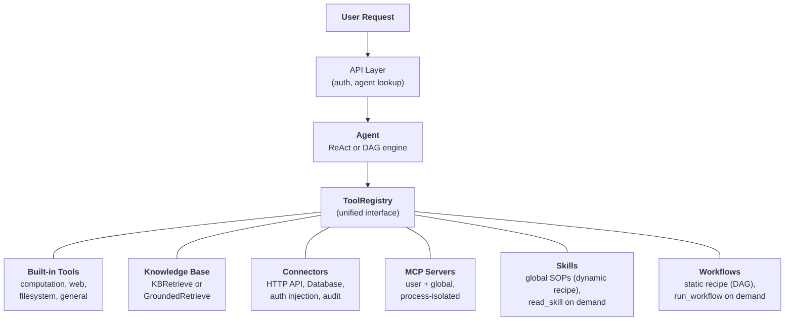
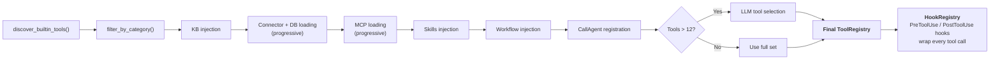
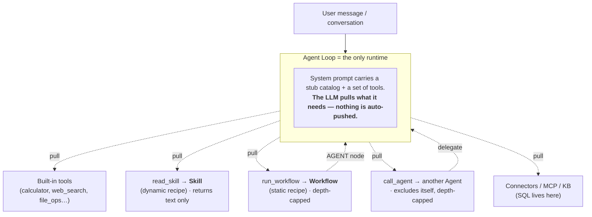

## The unified tool abstraction

The central design insight in FIM One is that **everything the agent can do is a tool**. A calculator, a knowledge base query, an ERP API call, and a third-party MCP server all implement the same `Tool` protocol: `name`, `description`, `parameters_schema`, `category`, and `run()`. The agent does not know or care whether it is calling a local Python function, querying a vector database, proxying into a legacy system, or invoking a community MCP server. It sees a flat list of callable tools in a `ToolRegistry`.

This is a deliberate architectural choice, not an accidental simplification. It means adding a new capability source never requires changing the agent, the execution engines, or the context management layer. You register tools; the agent uses them.

Six capability sources converge into one registry. The agent draws from all of them equally. Skills and Workflows are optional modules, off by default: until an administrator enables them under Admin → Settings → Modules, agents see neither. The last two are a matched pair: a **Skill** is a *dynamic recipe* (an SOP the LLM interprets step by step), and a **Workflow** is a *static recipe* (a deterministic graph that runs the same way every time). Both are pulled through a tool — `read_skill` and `run_workflow` respectively — and neither contains the other; they are peers consumed by the same runtime.

## 六个能力来源

### 内置工具

在启动时通过`discover_builtin_tools()`自动发现。将`BaseTool`子类放入`core/tool/builtin/`，它会自动注册，无需任何配置。类别包括计算（`calculator`、`python_exec`）、网络（`web_search`、`web_fetch`）、文件系统（`file_ops`）和通用（`json_transform`、`template_render`、`text_utils`）。这些是智能体的原生能力——始终可用，零配置。到达运营商所有通道的工具（`email_send`、`send_notification`）仅在运营商启用时才提供。

### 知识库

条件性。当智能体绑定了 `kb_ids` 时，通用的 `kb_retrieve` 工具会被替换为专门的检索工具。在**简单模式**下，`KBRetrieveTool` 执行基本的 RAG 检索。在**接地模式**下，`GroundedRetrieveTool` 运行一个 5 阶段的管道：多知识库检索、引用提取、对齐评分、冲突检测和置信度计算。知识库不是一个独立的子系统，而是作为专门的工具进入智能体——它受到与其他所有工具相同的 `Tool` 协议的约束。

### Connector

`ConnectorToolAdapter` wraps enterprise system actions as tools. Each action becomes a tool named `{connector}__{action}`, categorized as `connector`. The adapter adds HTTP proxy with auth injection (bearer, API key, basic), a per-action confirmation flag, response truncation, and audit logging. For direct database access, `DatabaseToolAdapter` provides schema-aware SQL execution, read-only by default. Connectors are the bridge between AI and legacy systems -- the core differentiator. See [Connector Architecture](/architecture/connector-architecture) for the full design.

### MCP

External MCP servers provide third-party tools via the standard protocol. An HTTP server is a remote endpoint; a stdio server is a process the platform starts inside its own container, which is why only system administrators can configure one. Tools are adapted into the `Tool` protocol and registered under category `mcp`. Admins can provision **global MCP servers** that load for all users automatically. MCP is the ecosystem play -- any MCP-compatible server works without custom integration.

### 技能

技能是可复用的标准操作程序 (SOP) -- 公司政策、处理流程、分步工作流 -- 全局应用，与选择的智能体无关。与连接器和知识库不同（可以限定到特定智能体），技能始终根据可见性（个人、组织共享或市场订阅）为每个用户加载。

技能支持两种注入模式 -- **渐进式**（默认）和**内联式** -- 由 `SKILL_TOOL_MODE` 控制。在渐进式模式下，紧凑的存根出现在系统提示中，LLM 按需调用 `read_skill(name)`。这是更广泛的[渐进式披露](/architecture/progressive-disclosure)架构的一部分，该架构在技能、连接器、数据库和 MCP 服务器中应用相同的存根优先、按需详情的模式。

要深入了解为什么技能是全局的（不与智能体绑定）以及它们如何与双模式资源发现交互，请参阅[智能体和资源发现](/architecture/agent-discovery)。

### Workflows

A Workflow is the **static recipe** to a Skill's dynamic one: a deterministic DAG an agent reaches for when a sub-task must run identically every time and leave an audit trail (scheduled reconciliations, multi-step approval-free pipelines). Like Skills, runnable Workflows are loaded globally per user by visibility — independent of agent selection — and exposed through a single `run_workflow(name, inputs)` tool, with each workflow's input fields advertised as a compact system-prompt stub. The LLM pulls one by name when a task maps onto it.

Only Workflows that are **active** and **free of human-approval (`HUMAN_INTERVENTION`) nodes** are inline-runnable — a gate that blocks for minutes or hours cannot sit inside an agent turn, so those Workflows remain trigger-only from the Workflows page. Inline runs execute as the user chatting with the agent: their connector and MCP credentials, their token quota, and the author's environment variables only when they are the author. Each run persists a `WorkflowRun` for the audit trail and is protected by a re-entrancy guard plus a nesting-depth cap so a Workflow's `AGENT` node can never start an unbounded call cycle.

## Per-request tool assembly

Every chat request assembles a fresh tool set through a filtering pipeline in `_resolve_tools()`. This is not a static configuration -- it is computed per request based on the agent's settings, the user's identity, and the available connectors and MCP servers.

The eight steps:

1. **Base discovery.** `discover_builtin_tools()` loads all built-in tools, scoped to the conversation's sandbox.
2. **Agent category filter.** `filter_by_category(*agent.tool_categories)` restricts to only the categories the agent is allowed to use.
3. **KB injection.** If the agent has `kb_ids`, the generic retrieval tool is replaced with `KBRetrieveTool` or `GroundedRetrieveTool` based on retrieval mode.
4. **Connector loading.** In agent-constrained mode, only the agent's bound connectors are loaded. In auto-discovery mode (no agent selected), all connectors visible to the user are loaded. Both API connectors (`ConnectorMetaTool`) and database connectors (`DatabaseMetaTool`) use [progressive disclosure](/architecture/progressive-disclosure) by default -- lightweight stubs in the system prompt, full schemas loaded on demand.
5. **MCP loading.** The user's personal MCP servers plus admin-provisioned global MCP servers are loaded and connected. In progressive mode (default), a single `MCPServerMetaTool` consolidates all servers; the LLM calls `discover` and `call` subcommands on demand. See [Progressive Disclosure](/architecture/progressive-disclosure).
6. **Skills + Workflows injection.** All active Skills visible to the user are loaded -- regardless of agent selection. In progressive mode, `ReadSkillTool` is registered with compact stubs in the system prompt; in inline mode, full Skill content is embedded directly. The same step loads all active, inline-runnable Workflows and registers `RunWorkflowTool` with one stub per workflow (name, description, input fields). Workflows carrying a human-approval node are skipped here.
7. **CallAgent registration (Auto mode only).** When no specific Agent is selected, all active, visible Agents are assembled into a catalog and exposed via `CallAgentTool`, enabling the LLM to delegate tasks to specialist agents. Delegated agents receive a full `ToolRegistry` built from their own configuration but exclude `call_agent` to prevent infinite recursion. When a specific Agent is selected, `CallAgentTool` is not registered — agents are specialized and do not delegate to other agents. This prevents marketplace agents from accessing other agents' private prompts.
8. **Runtime selection.** If the total tool count exceeds 12, a lightweight LLM call picks the most relevant subset (up to 6) for this specific query. A `request_tools` meta-tool is automatically registered, allowing the LLM to dynamically load additional tools mid-conversation if the initial selection missed a needed tool. Selection failure is non-fatal -- the agent falls back to the full set. See [Progressive Disclosure](/architecture/progressive-disclosure).
9. **Hook registration.** The agent's declared hooks (from `model_config_json.hooks`) are instantiated and attached to a `HookRegistry`. Each chosen tool call will be wrapped: `PreToolUse` hooks can block or rewrite args before execution; `PostToolUse` hooks can rewrite the observation before it returns to the LLM. Hooks run **outside the LLM loop** and cannot be bypassed by agent instructions — see [Hook System](/architecture/hook-system).

The result: the agent sees exactly the tools it needs, no more. A simple agent with no connectors and no KB might see 5 tools. An agent connected to 3 enterprise systems with a grounded knowledge base and 2 MCP servers might see 30 -- but after selection, only the 6 most relevant make it into the context.

## When to use what

| Need | Use | Why |
|------|-----|-----|
| General computation, code execution, text transforms | Built-in Tool | Always available, no config needed |
| Enterprise system integration (ERP, CRM, OA) | Connector | Auth governance, audit trail, per-action confirmation |
| Knowledge retrieval with citations and evidence | Knowledge Base | RAG pipeline, grounded generation, confidence scoring |
| Third-party tool ecosystem | MCP | Standard protocol, process isolation, community servers |
| Organizational policies, SOPs, handling procedures | Skill (dynamic recipe) | Global by default, progressive loading, visibility-scoped |
| A deterministic, repeatable multi-step process invoked mid-conversation | Workflow (static recipe) | Same output every run, audit trail, runs as the chatting user; human-gated ones stay trigger-only |
| Delegating tasks to specialist agents | CallAgent | Semantic agent routing, full tool inheritance, parallel execution |
| Direct database access | Database Connector | Schema-aware SQL, read-only by default |
| Custom internal tooling | MCP or Built-in | MCP for process isolation; built-in for tight integration |

The categories are not mutually exclusive. A single agent can use all five capability sources in one conversation -- loading a Skill for the complaint handling SOP, querying a knowledge base for policy documents, calling a connector to check the ERP, delegating analysis to a specialist agent (in Auto mode), and using a built-in tool to format the results.

## Execution engines are orthogonal

The tool system and execution engines are independent concerns. The LLM-driven engines (ReAct and DAG) consume tools from the same `ToolRegistry`. The choice of engine affects how tools are orchestrated, not which tools are available.

**ReAct** is an iterative tool loop. The agent reasons, picks a tool, observes the result, and repeats until done. It excels at exploratory, conversational tasks where the next step depends on the previous result. The loop runs up to 20 iterations by default (`REACT_MAX_ITERATIONS`) with per-iteration context management via ContextGuard. See [ReAct Engine](/architecture/react-engine) for implementation details.

**DAG** decomposes a goal into 2-6 parallel steps. Each step runs an independent ReAct agent. A PlanAnalyzer evaluates whether the goal was achieved; if not, the pipeline re-plans autonomously (up to 3 rounds in total: the first plan plus 2 re-plans). DAG excels at tasks with clear subtasks that can run concurrently -- "search three sources and compare results" finishes in the time of one search, not three. See [DAG Engine](/architecture/dag-engine) for the full pipeline.

The two engines share infrastructure: `structured_llm_call` for reliable structured output, `ContextGuard` for token budget enforcement, and the `ToolRegistry` for tool resolution. Adding a new tool requires zero changes to either engine. Adding a new engine (should one ever be needed) requires zero changes to the tool system.

Both engines also support **agent delegation** via `CallAgentTool` when in Auto mode (no agent selected). In native function-calling mode, the LLM can invoke multiple `call_agent` calls in a single turn, which execute concurrently via `asyncio.gather`. Each delegated agent receives its own `ToolRegistry` and runs as a full execution unit. For the detailed design of agent discovery, Skills as global SOPs, and agent delegation, see [Agent & Resource Discovery](/architecture/agent-discovery).

### 工作流引擎——第三范式

除了LLM驱动的ReAct和DAG引擎外，FIM One还包括**工作流引擎**——一个可视化DAG编辑器，具有9种核心节点类型（开始、结束、LLM、条件分支、智能体、知识检索、连接器、MCP、人工干预），用于固定流程自动化。对于灵活的、探索性的任务使用智能体；对于确定性的、可重复的流程使用工作流。详见[执行模式](/concepts/execution-modes)。

两者可以**双向组合**，但每个方向都通过单一运行时——智能体循环——路由，永远不会通过第二个执行引擎：

- **工作流→智能体。** 工作流的`AGENT`节点将智能体作为一个确定性步骤运行。
- **智能体→工作流。** 智能体（或它正在遵循的技能）调用`run_workflow`来委派必须确定性运行的子任务。

这解决了明显的循环担忧：只有**智能体循环是运行时**。技能和工作流是它加载的惯性配方；它们永远不会相互执行。"技能调用工作流"在物理上意味着智能体在遵循技能的SOP时调用`run_workflow`。每次调用都通过智能体，因此调用图是一个**星形**，而不是网格——反向边是有界的（`read_skill`仅返回文本；`call_agent`和`run_workflow`带有深度上限和重入保护）。

同一图片的两种理解：**工具被拉取，不被推送**（技能或工作流LLM从未选择的简单不会触发——这就是为什么动态能力在查询匹配之前会感到不可见），以及**技能和工作流是对等的**，通过一个运行时路由，而不是嵌套在彼此内部。

## Lifecycle overview

**Startup.** `start.sh` runs Alembic migrations, launches the FastAPI server, discovers built-in tools, and establishes MCP server connections for any pre-configured global servers.

**Per-request.** JWT authentication, agent configuration lookup, tool assembly (the 9-step pipeline above), engine selection (ReAct or DAG based on agent config), execution with SSE streaming, and result persistence.

**Cross-cutting concerns.** [Context management](/architecture/context-management) (5-layer token budget) protects every LLM call from overflow. The [Hook System](/architecture/hook-system) wraps every tool call with platform-controlled `PreToolUse` / `PostToolUse` logic — the mechanism behind human-in-the-loop approval (`ApprovalGateHook`), audit logging, and read-only-mode enforcement. Audit logging tracks every connector tool invocation. Sandbox isolation contains code execution tools. The two-LLM architecture (smart + fast) optimizes cost across planning, execution, and synthesis.

The architecture is designed so that each concern -- tool registration, execution orchestration, context management, security -- can evolve independently. A new connector type, a new execution engine, or a new context strategy can be added without cascading changes across the system.
