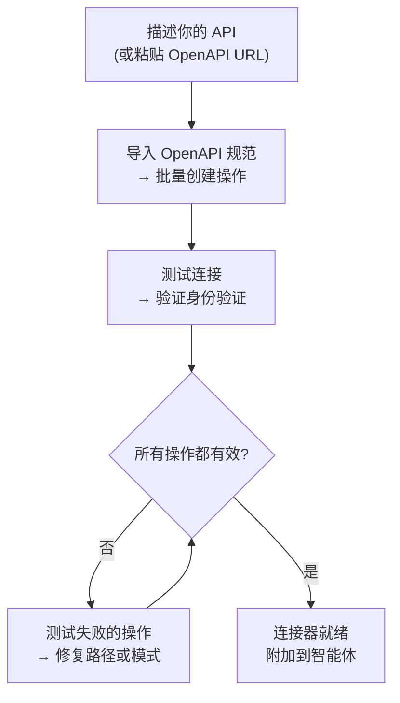
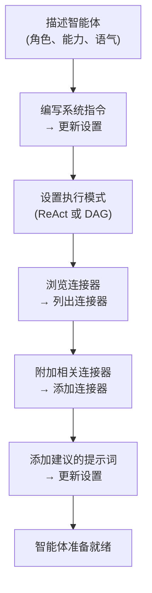

## 概述

AI Builder 让你用自然语言描述需求，由 AI 智能体为你配置。它有两种模式：

| 模式 | 工作原理 | 最适用于 |
|------|-------------|---------|
| **快速建议** | 单次 LLM 调用生成配置 | 快速初稿、简单 API |
| **高级构建器** | ReAct 智能体循环使用工具来构建、测试和优化 | 复杂 API、OpenAPI 导入、迭代优化 |

你可以随时在两种模式之间切换。快速模式创建起点；高级构建器让你进行迭代。

---

## 连接器构建器

**连接器**定义了 FIM One 如何与外部系统通信——其基础 URL、身份验证和它公开的特定 API 操作。连接器构建器为 AI 智能体提供了 9 个工具来代表您构建和管理此配置。

### 工具

| 工具 | 功能说明 |
|------|-------------|
| **获取设置** | 读取当前连接器配置（URL、身份验证类型、身份验证配置） |
| **更新设置** | 更改连接器名称、基础 URL 或身份验证凭证 |
| **列出操作** | 查看所有现有 API 操作及其方法和路径 |
| **创建操作** | 添加新的 API 端点 — HTTP 方法、路径、参数、请求体模板 |
| **更新操作** | 修改现有操作（描述、架构、响应提取） |
| **删除操作** | 移除不再需要的操作 |
| **测试操作** | 为任何操作发送实时 HTTP 请求并检查响应 |
| **测试连接** | 验证基础 URL 可访问且凭证被接受 |
| **导入 OpenAPI** | 从 Swagger 2.x 或 OpenAPI 3.x 规范批量导入最多 50 个端点 |

### 典型工作流

最常见的模式：粘贴 OpenAPI URL，让构建器完成其余工作。

**示例提示：**
> "从 `https://api.acme.com/openapi.json` 导入 OpenAPI 规范，然后使用 `order_id=12345` 测试 `GET /orders` 端点。"

构建器获取规范、自动创建所有操作、发送测试请求并报告结果 — 所有这一切都无需你触碰表单。

---

## 智能体构建器

一个**智能体**是一个具有一组指令、工具和（可选）连接器的命名 AI 角色。智能体构建器为 AI 智能体提供 6 个工具来从头开始配置另一个智能体。

### 工具

| 工具 | 功能 |
|------|-------------|
| **获取设置** | 读取当前智能体配置（指令、执行模式、工具、模型） |
| **更新设置** | 更改名称、描述、系统提示、执行模式或建议提示 |
| **列出连接器** | 浏览所有可用连接器（已附加和未附加） |
| **添加连接器** | 附加连接器，以便智能体可以将其操作作为工具调用 |
| **移除连接器** | 分离连接器（连接器本身不会被删除） |
| **设置模型** | 切换底层 LLM，或调整温度和最大令牌数 |

### 典型工作流程

从描述开始，让构建者配置整个智能体：

**示例提示词：**
> "创建一个财务副驾驶。它应该使用 Acme 连接器回答关于订单和发票的问题。使用 ReAct 模式并为常见问题添加 3 个建议的提示词。"

构建者读取当前设置、编写系统提示词、附加连接器、设置执行模式并添加建议的提示词 — 在单个对话轮次中完成。

---

## How it works

Under the hood, the builders share the same infrastructure as regular agents:

| Builder mode | Mechanism |
|-------------|-----------|
| **Quick suggestions** | A single LLM inference call generates the full configuration as structured JSON |
| **Advanced builder** | A ReAct agent loop: Reason → call a builder tool → observe the result → decide next step |

The advanced builder is a full ReAct agent that happens to have a restricted toolset — the 9 Connector or 6 Agent builder tools (the Connector builder also gets web search and fetch, to read API docs) and no code execution. A third builder with its own tool set configures database connectors: connection test, table listing, schema annotation and sample queries. It reads the current state of the target resource, plans what needs to change, calls the appropriate tools, and verifies the result before declaring it done.

This means the advanced builder can handle ambiguity: if the OpenAPI import creates 30 actions but only 5 are relevant, you can tell it "keep only the order-related endpoints" and it will delete the rest.
