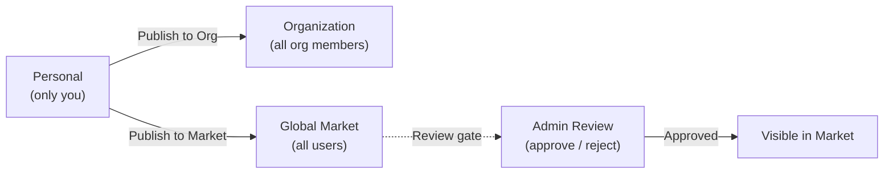

The Market is FIM One's built-in resource marketplace. It organizes shared resources into two tiers:

- **Solutions** -- high-level resources that deliver end-to-end capabilities: Agents, Skills, and Workflows.
- **Components** -- building blocks that Solutions depend on: Connectors and MCP Servers.

Skills and Workflows are optional modules, off by default. They appear in the Market only after an administrator enables them under Admin → Settings → Modules.

You browse by scope (your Organization or the Global Market), find what you need, subscribe, and start using it -- all without leaving FIM One.

<Info>
The Market uses a **pull model**: resources are discovered by browsing and explicitly subscribed to. There is no auto-join or push mechanism -- you choose what to install, and you can filter by scope at any time.
</Info>

## 我可以找到什么？

### 解决方案

解决方案是完整的、即用型的功能，您可以订阅并立即投入使用。

| 资源 | 类别 | 您获得的内容 |
|---|---|---|
| **智能体** | 解决方案 | 一个具有绑定工具和知识的专家 AI 助手 |
| **技能** | 解决方案 | 注入到系统提示中的全局标准操作流程，可以编排智能体 |
| **工作流** | 解决方案 | 用于计划或触发执行的 DAG 自动化流 |

### Components

Components are the integrations and tool services that Solutions are built from.

| Resource | Category | What you get |
|---|---|---|
| **Connector** | Component | API integration available as agent tools (database connectors cannot be published) |
| **MCP Server** | Component | Third-party tool service loaded into sessions |

<Tip>
Knowledge Bases never appear in the Market and are never subscribed. An Agent that uses a KB delegates its owner's content at run time, so subscribing to the Agent is all you need.
</Tip>

## Scope

The Market has a scope selector at the top of the page. The UI and subscription flow are identical in both scopes -- only the visibility of resources changes.

- **Organization** -- resources shared within your team or company. Publishing here does not require review unless the organization has turned review on for that resource type.
- **Global Market** -- resources from the entire FIM One community. Publishing here requires admin approval.

Switch between scopes at any time to explore what is available.

## 我如何订阅？

当你找到想要的资源时，点击**订阅**。一个入门向导会引导你完成任何必需的设置 -- 例如，为连接器输入 API 凭证。如果你愿意，可以跳过向导，稍后再配置凭证。

订阅后：

- **智能体**会出现在你的智能体选择器和 `call_agent` 目录中。
- **技能**会自动注入到你的系统提示中。
- **工作流**会出现在你的工作流列表中，准备好运行。
- **连接器**会出现在你的工具集和智能体绑定下拉菜单中。
- **MCP 服务器**会将其工具加载到你的会话中。

如果一个解决方案依赖于组件（例如，使用特定连接器的智能体），这些依赖关系会在订阅期间自动解决。系统会提示你输入任何必需的凭证。

订阅是即时的 -- 无需发布者的批准。你可以随时取消订阅以从工作区中删除该资源。

## How Do I Publish?

Any resource owner can publish to make their resource discoverable. Publishing can target either your Organization or the Global Market.

| Target | Who can see it | Review required? |
|---|---|---|
| **Organization** | All members of your org | No by default; an org can require review per resource type |
| **Global Market** | All authenticated users | Yes -- admin approval required |

Publishing to the Global Market always goes through a review gate. Admins can approve, reject (with a note), or leave the resource pending. Rejected resources can be revised and resubmitted.

## What About Credentials?

When you subscribe to a resource that requires credentials (API keys, OAuth tokens), the onboarding wizard collects them during subscription. Credentials are stored securely and scoped to your account -- no one else can see them.

You can update or rotate credentials at any time from the resource's settings page.

## How It Integrates

Under the hood, the Market is implemented as a **shadow organization** -- an invisible system org that holds no members. Resources published to the Global Market are set to `visibility: "org"` within this shadow org, which allows the existing visibility system to include them naturally.

This means the Market requires **zero special-case code** in the tool assembly pipeline. The same visibility filter (own, or subscribed and still shared) that loads personal and org resources also loads Market resources. When you subscribe, a subscription record is created, and the resource appears in your visibility filter automatically.

For Solutions that bundle dependencies (e.g., an Agent with bound Connectors and Knowledge Bases), the subscription process resolves and provisions those dependencies so everything works out of the box.

For technical details on how the visibility filter works across all resource types, see [Agent & Resource Discovery -- Visibility Model](/architecture/agent-discovery#visibility-model).
