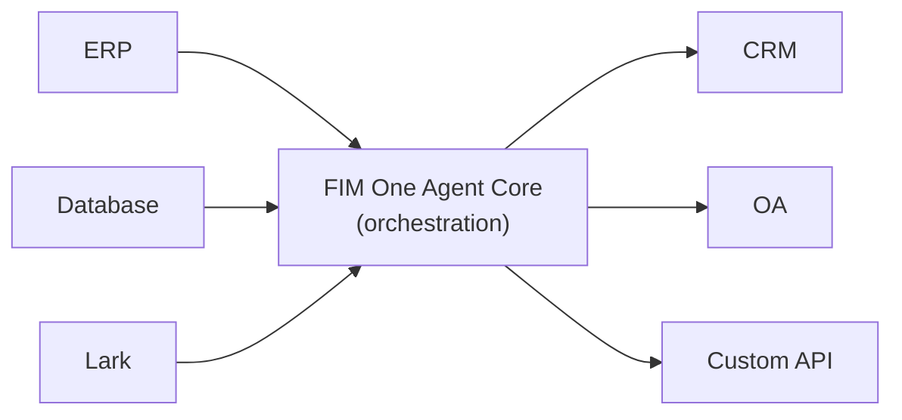

欢迎使用FIM One，这是一个由AI驱动的框架，用于构建能够在企业系统之间动态规划并执行复杂任务的智能体。

  <a href="https://one.fim.ai/">网站</a> · <a href="https://github.com/fim-ai/fim-one">GitHub</a> · <a href="https://discord.gg/z64czxdC7z">Discord</a> · <a href="https://x.com/FIM_One">Twitter</a>

<Tip>
  **☁️ 在云端试用FIM One——无需设置。**
  托管版本已在[**cloud.fim.ai**](https://cloud.fim.ai/)上线：无需Docker，无需API密钥，只需登录即可开始连接您的系统。_早期访问——欢迎反馈。_
</Tip>

## FIM One 是什么？

FIM One 是一个与提供商无关的 Python 框架，用于构建与现有系统协作的 AI 智能体。与要求你复制逻辑的工作流构建器不同，FIM One 主动桥接你的系统——读取数据库、调用 API、推送通知——所有这些都通过统一的 AI 界面完成。

核心洞察：**三种交付模式，一个智能体核心**。

## Three Delivery Modes

| Mode | What it is | Delivery | Use Case |
|------|-----------|----------|----------|
| **Standalone** | General-purpose AI assistant — search, code, knowledge base | Portal | Chat, code execution, knowledge base Q&A |
| **Copilot** | AI embedded in a host system — works alongside users in their existing UI | API today; iframe / widget embed is planned | "Finance Copilot" in your ERP web UI |
| **Hub** | Central cross-system orchestration — all your systems connected | Portal / API | Agent queries ERP, checks OA, notifies via Lark |

## 一个智能体核心，服务所有系统

智能体核心是差异化因素——一个中央编排层，全球SaaS、中国企业栈以及介于两者之间的一切都在这里与AI相遇：

每个连接器都是一个标准化的桥梁。智能体不知道也不关心它是在与SAP还是自定义PostgreSQL数据库通信。你的数据保留在你的系统中；FIM One提供了跨系统编排的AI层。

## 快速开始

探索以下部分以了解 FIM One 的架构并部署它：

- **[快速开始](/quickstart)** — 使用 Docker 或本地开发在几分钟内运行 FIM One
- **[执行模式](/concepts/execution-modes)** — 深入了解独立、副驾驶和中心模式
- **[AI 构建器](/concepts/ai-builder)** — 使用 AI 通过自然语言构建连接器和智能体
- **[连接器架构](/architecture/connector-architecture)** — FIM One 如何通过 AI 连接遗留系统
- **[理念](/architecture/philosophy)** — 为什么动态规划是刚性工作流和完全自主智能体之间的正确平衡
