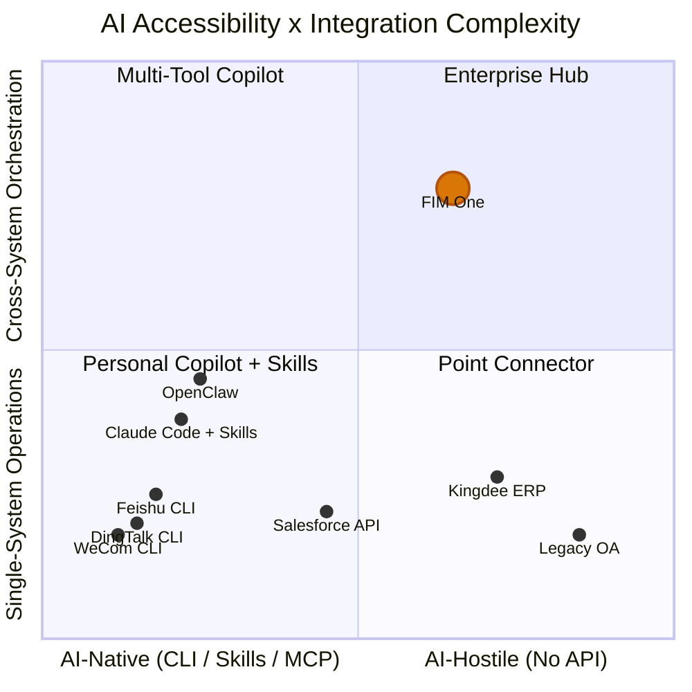

## 2026年3月信号

2026年3月，三个主要的中国工作场景平台在同一周内开源了CLI工具：

- **钉钉**发布了`dws` — 覆盖12个业务领域的104个工具
- **飞书/Lark**发布了`lark-cli` — 覆盖11个领域的200+命令
- **企业微信**发布了`wecom-cli` — 覆盖7个业务领域

他们都没有选择MCP。三家都发布了纯CLI工具，通过`npx skills add`分发预打包的AI Skills。这是业界首次集体展示了AI智能体应该如何与企业系统交互的方案 — 答案不是协议，而是打包格式。

本文档分析了这对AI系统集成的广泛意义，以及对FIM One战略的具体影响。

## AI 系统集成的三种范式

### 1. REST API（传统方式）

基线方案。每个 SaaS 平台都会暴露 HTTP 端点，并使用 OpenAPI 规范进行文档化。AI 集成需要一个适配层——将"使用这些请求头和 JSON 请求体调用该 API 端点"转换为"这是智能体可以调用的工具"。

这正是 FIM One 的 ConnectorToolAdapter 目前所做的工作。它能正常运行，但每个集成都需要自定义工作：阅读 API 文档、处理身份验证、映射响应格式、处理分页。

- **使用者**：每个 SaaS 平台、遗留集成
- **AI 集成**：需要适配层（ConnectorToolAdapter、自定义代码）
- **优势**：通用、易于理解、结构化 JSON I/O
- **劣势**：每个集成都需要自定义开发工作

### 2. CLI + Skills（新兴）

该平台提供编译后的 CLI 二进制文件。AI 集成通过预打包的 Skill 文件实现——这些是 markdown 文档，教会 AI IDE 如何通过子进程调用 CLI 命令。分发通过 npm 进行：`npx skills add dingtalk/dws`。

AI 读取 Skill 文件，理解有哪些可用命令及其参数，然后以子进程方式调用 CLI。输出通常是自由文本（表格、格式化字符串），AI 必须对其进行解析。

- **使用者**：钉钉、飞书、企业微信（都在 2026 年 3 月选择了这种方式）
- **AI 集成**：`npx skills add platform/cli` — AI IDE 读取 Skill markdown，调用 CLI 命令
- **优势**：快速交付，适用于任何支持 Skills 格式的 AI IDE
- **劣势**：非结构化文本输出（AI 必须解析）、无标准化发现协议、单平台范围

### 3. MCP (Model Context Protocol)

JSON-RPC over stdio or SSE。结构化工具发现（`tools/list`）和调用（`tools/call`）。AI 客户端与服务器协商能力，获取每个工具的类型化模式，并接收结构化的 `CallToolResult` 响应。

- **谁使用它**：Anthropic 生态系统，越来越多的开发者工具
- **AI 集成**：原生协议 — 结构化 I/O、基于模式的发现
- **优势**：标准化、结构化、可组合、为多工具编排而构建
- **劣势**：实现成本较高，尚未被主要工作场所平台采用

### 比较

| 维度 | REST API | CLI + Skills | MCP |
|-----------|----------|-------------|-----|
| 标准化 | 中等 (OpenAPI) | 低 (特定厂商 Skills) | 高 (JSON-RPC 协议) |
| AI 友好性 | 低 (需要适配器) | 中等 (文本 I/O，由 AI 解析) | 高 (结构化 JSON I/O) |
| 发现机制 | OpenAPI 规范 / 文档 | `--help` + Skill markdown | `tools/list` 协议端点 |
| 输出格式 | 结构化 JSON | 自由文本 (需要 AI 解析) | 结构化 `CallToolResult` |
| 交付时间 | 数周 (每个集成) | 数天 (包装现有 API) | 数周 (实现协议) |
| 跨平台编排 | 需要 hub | 未内置 | 未内置 |
| 企业治理 | 需要 hub | 未内置 | 未内置 |

## 主要平台的实际选择

| | DingTalk `dws` | Feishu `lark-cli` | WeCom `wecom-cli` |
|---|---|---|---|
| 语言 | Go | Go + Python | Rust + TS |
| 工具 | 104 / 12 个域 | 200+ / 11 个域 | 7 个域 |
| MCP 支持 | 否 | 否 | 否 |
| AI 集成 | Markdown Skills + schema 内省 | 19 个 npm Skills (`npx skills add`) | 12 个 npm Skills (`npx skills add`) |
| 输出格式 | JSON / table / raw + `--jq` | JSON / table / csv / ndjson | JSON |
| 智能体友好的标志 | `--yes`, `--dry-run`, 智能输入纠正 | `--no-wait`, `--as user/bot`, `--dry-run` | 直接 JSON 参数 |
| 发现 | `dws schema`（自省） | `lark-cli schema`（自省） | 仅通过 Skill 文件 |

关键观察：`npx skills add` 正在成为 AI 工具集成的事实上的分发渠道，完全绕过了 MCP。这些平台选择了快速上市而非协议标准化。AI IDE 生态系统（Cursor、Claude Code、Windsurf）已经理解 Skills 文件，因此这些平台无需实现协议服务器就能获得即时的 AI 集成。

## AI 可访问性谱系

并非所有系统对 AI 的可访问性都相同，也并非所有任务的复杂度都一样。这两个维度定义了不同集成方法创造价值的位置。

**图表解读：**

- **左下角（个人副驾驶 + 技能）**：具有简单操作的 AI 原生平台。DingTalk、Feishu 和 WeCom 聚集在这里——它们提供自己的 CLI + 技能，使单平台 AI 集成成为自助服务。OpenClaw 和 Claude Code with Skills 等个人副驾驶占据这个区域。FIM One 在这里增加的价值很少——平台已经完成了这项工作。
- **左上角（多工具副驾驶）**：具有跨系统需求的 AI 原生平台。用户在 Claude Code 中安装多个技能（`dingtalk` + `feishu` + `wechat`）可以尝试多平台协调，但缺乏治理、编排规划和统一的凭证管理。
- **右下角（点连接器）**：需要简单桥接的遗留系统。单个连接器连接到金蝶 ERP 或遗留 OA 系统——FIM One 在这里作为适配器很有用，即使是单系统操作，因为这些系统没有 CLI，API 有限或没有。
- **右上角（企业枢纽）**：具有跨系统编排需求的遗留或 API 受限系统。这是 FIM One 的优势所在。跨遗留管理系统查询合同、与 ERP 应收账款关联，以及通过 DingTalk 发送催收通知——这需要 DAG 规划、多连接器协调、凭证保管库、审计跟踪和人工确认门。没有个人副驾驶、没有 CLI、没有技能文件能够到达这里。

当你向右上角移动时，FIM One 的价值会增加：难以访问的系统结合更复杂的编排需求。提供自己的 CLI + 技能的平台占据相反的角落——易于访问、简单操作——代表 FIM One 不应该追求的市场。

## 个人 Copilot vs 企业中心

个人 AI copilot 的激增（OpenClaw、Claude Code、Cursor、Windsurf）引发了一个定位问题。存在两种根本不同的模式：

### 个人副驾驶

- **用户**: 个人开发者或知识工作者
- **数据范围**: 我的日历、我的电子邮件、我的文档
- **身份验证**: 我的个人 token、我的 OAuth 会话
- **集成范围**: 单人、少数平台、个人生产力
- **治理**: 无需治理 — 这是我的数据、我的操作

### 企业集成平台

- **用户**：组织（团队、部门、跨职能工作流）
- **数据范围**：跨部门、跨系统，包括敏感数据和受监管数据
- **身份验证**：管理员分配的权限、最小权限、凭据保管
- **集成范围**：多系统编排、业务流程自动化
- **治理**：审计日志、RBAC、确认闸门、合规要求

两者是互补关系，而非竞争关系。随着个人智能副驾不断普及，企业将需要一个中央枢纽来治理这些智能副驾可以访问的内容。个人用户使用Claude Code和`npx skills add dingtalk/dws`时，可以读取自己的DingTalk消息。但当一个智能体需要跨DingTalk、公司ERP和财务系统进行编排，并为写入操作提供审计追踪、权限控制和人工确认时，这完全是另一个问题。

个人智能副驾会使简单的单平台操作趋于商品化。这不是FIM One的市场。FIM One的市场是跨系统、需要治理、包含遗留系统的企业集成，这是任何个人智能副驾都无法处理的问题。

## 对 FIM One 的战略影响

| 优先级 | 行动 | 理由 |
|----------|--------|-----------|
| 坚持当前方向 | 持续投资于围绕 API、数据库和 MCP 访问的治理层（凭证、确认闸门、审计） | CLI + Skills 永远无法触达遗留系统，而跨系统访问需要治理 |
| 拥抱 MCP | MCP Server 支持已经构建完成（`MCPServerMetaTool`）——继续打磨 | MCP 是结构化协议方向的押注；一些平台最终会采用它 |
| 关注 Skills | 跟踪 `npx skills add` 生态，但不要盲目追逐 | Skills 解决的是分发问题，而 FIM One 并不存在这个问题 |
| 在治理方面形成差异化 | 审计、RBAC、确认闸门、凭证管理 | 面向个人的副驾驶永远不会提供企业级治理 |
| 明确定位 | “面向全球×中国企业的一体化智能体平台”——而不是“另一种调用 DingTalk 的方式” | 避免在平台免费提供的简单集成上竞争 |

最糟糕的战略举措，是为了应对 CLI + Skills 浪潮，而为已经提供自身 Skills 的平台构建 Skills 适配器。这是在与平台厂商自身进行一场逐底竞争。正确的应对方式，是继续专注于那些平台厂商永远无法触达的系统。

## CLI、Skills 与 MCP 之间的关系

这三个概念处于不同层次，在讨论中经常被混为一谈。准确的区分如下：

- **CLI** 是用户界面——shell 命令、文本 I/O，以及与系统交互的一种形态
- **Skills** 是分发机制——用于教 AI 调用 CLI 命令的 Markdown 文件，也是 AI 工具集成的一种打包格式
- **MCP** 是协议——基于 JSON-RPC，提供结构化发现与调用，是 AI 与工具通信的互操作性标准

从长远来看，它们并不能相互替代。CLI 是人类（或 AI 子进程）与工具交互的方式。Skill 文件是将 CLI 分发到 AI IDE 中的方式。MCP 则是让结构化、基于 schema 类型约束且可组合的集成在协议层运行的方式。

不过，短期内（2026 年），CLI + Skills 凭借更快的采用速度占据优势，因为它的实现成本低于 MCP。拥有现有 CLI 的平台可以在一天内发布一个 Skills 文件。而实现 MCP 服务器则需要数周时间，并且要求理解协议规范、传输层和能力协商。

可能的融合路径是：如今发布 CLI 的平台，未来可能会将其封装为 MCP 服务器。MCP 的 stdio 传输方式已经可以启动 CLI 进程——“通过 Skills 调用 CLI”和“将 CLI 封装为 MCP 服务器”之间的差距很小。但这种融合并非必然。如果 Skills 生态发展足够快，并且 AI IDE 围绕它实现标准化，那么 MCP 可能会继续作为开发者工具协议，而不是企业工具标准。

对于 FIM One 而言，结论很明确：应投资于协议层（MCP）和治理层（凭据、确认闸门、审计），而不是分发层（Skills）。对于平台供应商而言，分发已经是一个得到解决的问题。协议和治理才是枢纽能够创造持久价值的领域。
