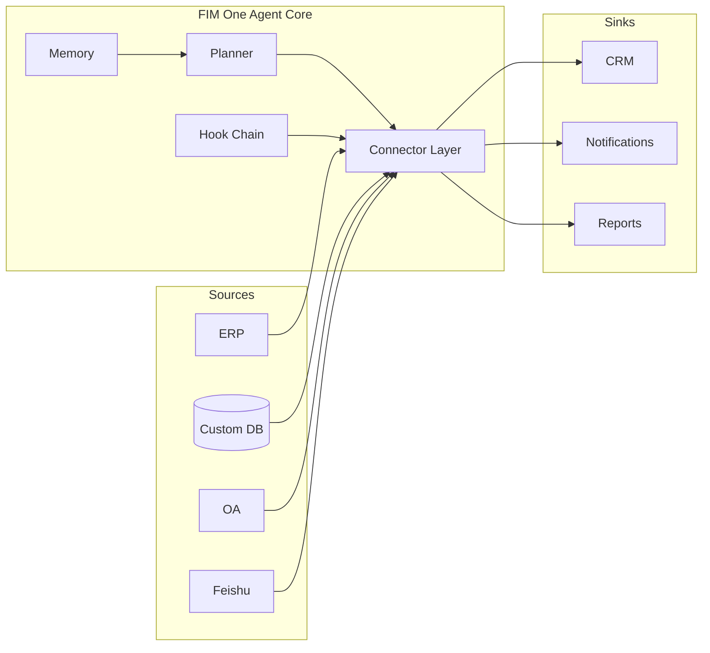

<Info>
  **版本 1.1 · 2026 年 4 月。** 本白皮书介绍 FIM One 的架构理念、类别定位和部署模型。
  面向正在评估如何将 AI 引入现有系统的 CTO、企业架构师、AI 平台负责人和技术投资者。
</Info>

## 执行摘要

**数据永不离开您的边界。** 这一句话是FIM One背后每个决策的一阶设计约束，也是需要一个新基础设施层的原因——不是另一个iPaaS，也不是另一个通用智能体。

大多数企业已经拥有他们需要的系统——ERP、CRM、OA、自定义数据库、内部API、行业SaaS。他们缺少的是让AI能够**触达**这些系统的方式，而无需将数据迁移到供应商云端，也无需为每个用例进行为期六个月的集成项目。市场规模庞大、发展迅速，并且已在重新定位：全球企业GenAI基础设施支出预计在2025年达到**US$18B，同比增长3.2倍**（Menlo Ventures 2025）。中国的增速更快——企业AI智能体支出达到**120% CAGR（2023–2027），到2027年将达到¥65.5B**（iResearch · CAICT 2025）。中央/国有企业占大模型采购的**60%以上**，信创（信创）私有部署是硬性约束。

Gartner已正式将此类别重新命名为"AI Agent Platform"（文档6300015，2025）；CAICT的2025智能体AI技术报告称其为"智能体平台"；历史上的iPaaS领导者MuleSoft在2025年iPaaS魔力象限中**从Leader降级为Challenger**。主导企业集成十年的类别正在被实时替代。

FIM One为新类别而构建。它是一个**一体化智能体平台**，面向全球×中国企业——一个提供商无关的Python框架，其中AI智能体动态规划和执行跨越您现有系统的任务，通过一个智能体核心连接全球SaaS和中国栈，部署在您自己的环境中，端到端可审计。一个智能体核心，三种交付模式：

| 模式 | 部署位置 | 典型应用 |
|---|---|---|
| **独立版** | 自有门户 | 知识问答、内部聊天、代码沙箱 |
| **副驾驶** | 嵌入宿主系统内 | ERP网页UI内的"财务副驾驶" |
| **中枢** | 跨系统中央编排器 | 智能体查询ERP、检查OA、通过Feishu通知 |

本文阐述了为什么该类别在发生变化、为什么iPaaS无法承载新工作负载、FIM One在底层是什么样的，以及您如何将其投入生产。

## 1. 问题所在：企业AI是一个对齐问题

2025–2026年的公开AI讨论一直被模型能力主导——更长的上下文、更好的推理、更便宜的token。在企业内部，能力很少是瓶颈。瓶颈在于**AI在你的系统内部没有"手"**。

一个能读懂万行代码库并提出正确修复方案的前沿LLM，本身无法：

- 从本地部署的SAP实例中提取昨天的库存数据。
- 在只有遗留SOAP API集成接口的SaaS HR工具中批准休假请求。
- 向符合信创标准的ERP中写入一行数据，其身份验证是登录票据服务而非OAuth2。
- 向飞书群组发送通知，同时遵守该群组自身的审批规则。

这些都是已解决的集成问题——各自一次。困难在于每个企业都有数十个这样的系统，每个系统都有自己的身份验证模型、数据形状和故障模式。硬编码它们会给你一个脆弱的单体。让LLM在运行时发现它们会导致幻觉API调用。

**缺失的原始设计是一个对齐的接口。** 一个类型化、经过身份验证、可发现的模型与系统之间的接口——它告诉模型它能做什么、每个操作的成本、谁必须批准它，以及结果会是什么样子。这个原始设计就是FIM One所说的**连接器**。

## 2. 为什么现有方法不足

### 2.1 iPaaS和工作流构建器——一个衰退的类别

iPaaS（MuleSoft、Boomi、Workato）和轻量级工作流家族（n8n、Zapier、Dify、Coze）将集成视为**设计时**问题：人类绘制节点图并在字段级粒度进行连接，该图在运行时确定性地运行。当集成数量少且稳定时，这种方法是可行的。

但它不适用于AI驱动的企业自动化，原因有三：

1. **逻辑已经存在于目标系统内。** 每个节点都是围绕API调用的薄包装，而你现在需要在两个地方维护它。
2. **人类必须提前知道计划。** 企业问题如"关闭所有亚太地区实体的Q1"是开放式的——计划必须在运行时生成，而不是由设计师绘制。
3. **字段级映射在规模上崩溃。** 跨十几个系统的千节点图无法维护；AI可读的操作界面完全取代了它。

该类别正在明显转变。Gartner在2025年将该领域重新分类为"AI智能体平台"（文档6300015）。CAICT在其2025年智能体AI技术报告中采用了相同的框架（"智能体平台"）。最能说明问题的是，**作为十年来iPaaS参考供应商的MuleSoft——在Gartner 2025年iPaaS魔力象限中从领导者降级为挑战者**。与此同时，Anthropic的MCP协议在2024年11月发布后，在15个月内增长到**10,000+个服务器和9,700万次月度SDK下载**。信号很明确：企业自动化的集成层正在被重建。

### 2.2 通用智能体（Manus、AutoGPT、OpenAI Assistants）

通用智能体设计用于消费者和知识工作任务——浏览网页、起草文档、操作电子表格。它们无法进入你的VPN、向你的ERP进行身份验证或通过你的安全审查。当围绕企业系统部署时，它们成为在试点阶段就失败的演示。

### 2.3 厂商内置AI（飞书AI、SAP Joule、Salesforce Einstein）

厂商已将自己的AI内置到自己的产品中。问题在于结构性的：**任何上游厂商都没有动力去打破自己的数据孤岛。** 飞书AI不了解你的ERP数据；钉钉AI不了解你的合同状态。每个厂商的AI只能看到该厂商卖给你的内容。对于跨系统工作，它们根本无法胜任。

### 2.4 自建和RPA

自建方案周期长、适配成本高。RPA像人类一样驱动UI——这是最通用的方法，也是最脆弱的：每次UI变化都会破坏它，每个身份验证提示都会让它停止。它只是对缺失API的补丁，不是构建AI的基础。

FIM One占据了这些方案都留下的空白：对真实系统的类型化API，由模型规划，由企业治理，部署在企业边界内。

## 3. FIM One 论文

三项信念塑造了每一个设计决策。

**信念 1——系统已经存在。** 不要求企业重建；在企业所在的地方与其相遇。每个连接器都是一座桥梁，而非替代品。数据永远不会离开信息源，也永远不会离开企业边界。

**信念 2——对齐优于能力。** 一个较弱但工具集对齐的模型胜过一个在原始 API 上摸索的更强模型。护城河是连接器库、其认证模型和治理层——而非智能体的原始推理能力。

**信念 3——动态规划是正确的中间立场。** 刚性工作流（iPaaS、BPM）对真实企业任务过于脆弱；完全自主智能体（AutoGPT、Manus）对生产环境过于不可预测。FIM One 在运行时规划，但在类型化的行动空间内——每一步都是连接器调用，而非开放式的 LLM 独白。有界自主性：`re-plan ≤ 3 | token budget | confirmation gate`。

### 超越iPaaS

FIM One刻意不是iPaaS，这种区别不仅仅是表面的。iPaaS是字段级、设计时、人工建模、供应商云托管的。FIM One是操作级、运行时、模型规划、企业自托管的。

| 维度 | iPaaS | FIM One |
|---|---|---|
| 粒度 | 字段映射 | 类型化操作 |
| 规划时间 | 设计时 | 运行时 |
| 谁来建模 | 人工设计师 | 模型 |
| 数据位置 | 供应商云 | 您的服务器 |
| 治理 | 外部附加组件 | 内置钩子 |
| 分类（Gartner 2025） | iPaaS MQ（衰退中） | AI Agent Platform |

## 4. Architecture Principles

<CardGroup cols={2}>
  <Card title="Provider-Agnostic" icon="shuffle">
    Any OpenAI-compatible LLM — OpenAI, Anthropic, DeepSeek, Qwen, local Ollama, Xinchuang-certified models. Model choice is a deployment variable, not an architectural commitment.
  </Card>
  <Card title="Protocol-First" icon="network-wired">
    Every connector publishes a typed schema. The agent sees actions, parameters, and return types — never raw HTTP. OpenAPI, MCP, and direct database connections are first-class.
  </Card>
  <Card title="Three Execution Engines" icon="sitemap">
    **ReAct** for exploratory tasks, **DAG** for structured pipelines, **Workflow** (visual editor, 9 node types, an optional module) for deterministic human-designed pipelines. One agent core picks the engine per task.
  </Card>
  <Card title="Schema-First Tool Loading" icon="bolt">
    Tool schemas are pre-seeded at ~30 tokens each; the agent expands on demand. Per-session prompt overhead drops ~80%, and the platform scales to **10,000+ APIs** without blowing the context window.
  </Card>
  <Card title="Hook-Governed" icon="shield-halved">
    Every tool call passes through a configurable hook chain: audit, policy, human-in-the-loop approval. Hooks run outside the LLM loop — deterministic and auditable.
  </Card>
  <Card title="Memory-Aware" icon="brain">
    Short-term conversation, long-term knowledge base, and cross-session memory are first-class primitives, not bolt-ons.
  </Card>
</CardGroup>

## 5. Three Delivery Modes — One Agent Core

The same planner, memory, and connector library power three distinct product shapes. The choice is a deployment decision, not a code fork.

**Standalone** — a self-contained portal. The buyer wants a chat interface over a curated knowledge base, or a code sandbox, or a general assistant. No host system involved. Fits internal IT help desks, engineering productivity, customer-support KBs.

**Copilot** — the agent embedded inside an existing host system. Today the host UI calls the FIM One API; a drop-in iframe / widget embed, with the user's identity passed from the host, is planned. Fits Finance Copilot inside SAP Fiori, Sales Copilot inside Salesforce, DevOps Copilot inside an internal developer portal.

**Hub** — the central orchestration surface. Every connected system terminates here. Users ask cross-system questions; the agent plans and executes across systems. Fits "close out Q1 for all APAC entities", "find every customer who missed a renewal and draft outreach", "reconcile yesterday's payments between gateway and ledger".

## 6. Connector Alignment Model

A connector is a typed action surface backed by an auth strategy. FIM One defines three auth tiers that cover the vast majority of enterprise systems.

<AccordionGroup>
  <Accordion title="Tier 1 — Database Connectors">
    Direct connection to a relational database. The agent writes SQL against the introspected schema; a connector is read-only by default, stays private to its owner, and columns marked as personal data come back masked. Native support for **Xinchuang-compliant databases — Dameng (DM8), KingbaseES, HighGo** — alongside PostgreSQL and MySQL. Central/state-owned and regulated customers pass compliance procurement day-one.
  </Accordion>
  <Accordion title="Tier 2 — OpenAPI Connectors (User-Key)">
    Any REST API with an OpenAPI specification. The agent reads the spec, selects the endpoint, and calls it with the logged-in user's key. Covers modern SaaS (Slack, Linear, GitHub) and well-documented internal APIs.
  </Accordion>
  <Accordion title="Tier 3 — Login-Ticket / Legacy Connectors (planned)">
    For systems — particularly common in the Chinese market — that authenticate via a login-ticket service rather than OAuth2. The connector will manage the ticket lifecycle (acquire, refresh, invalidate) and present a normal typed surface upward. Not shipped yet: today API connectors authenticate with a bearer token, an API key, or basic auth.
  </Accordion>
</AccordionGroup>

Each connector also declares a **Channel/Integration duality**: the same underlying system can appear both as a *channel* (notification sink, approval surface) and as an *integration* (data source, action target). Feishu is both a notification channel and a group-chat data source; DingTalk and WeCom follow the same pattern.

## 7. Trustworthy Enterprise AI — Three Pillars

Enterprise AI fails in production not because the model is wrong but because the organization cannot prove it is right. FIM One treats trust as architecture, expressed in three pillars.

<CardGroup cols={3}>
  <Card title="Every Conclusion Is Cited" icon="paperclip">
    RAG retrieval + citation chain lets the agent reference a specific paragraph in a specific document for every claim. Conclusions are traceable and auditable. No black-box output.
  </Card>
  <Card title="Sensitive Actions Are Confirmed" icon="hand">
    Actions marked as requiring confirmation (or every tool call, when an agent is set to confirm all) pause before execution, waiting for a human approval — inline in the portal or out-of-band via a Feishu approval group. The hook chain is an architectural constraint, not a policy suggestion. It cannot be bypassed.
  </Card>
  <Card title="Every Release Is Measured" icon="chart-bar">
    Dataset-driven evaluation quantifies quality before each release. Every iteration is measurable; enterprise procurement gets evidence, not promises.
  </Card>
</CardGroup>

Supporting this, every agent run emits a structured trace: plan, tool calls, arguments, observations, approvals, final answer. Traces are the unit of audit. Credentials use Fernet encryption (AES-128-CBC + HMAC-SHA256). Full audit logs are stored and exportable.

When an operator rejects a tool call, the agent stops — it does not paraphrase and retry. Rejection is a policy decision, not an error to recover from.

## 8. Deployment and Business Model

FIM One ships with public source under the FIM One Source Available License (FIM-SAL) — source-available, not OSI-approved open source — with three deployment shapes and three edition tiers.

<CardGroup cols={3}>
  <Card title="Community" icon="code">
    Free forever. Self-hosted. For developers and evaluation teams.
  </Card>
  <Card title="Cloud" icon="cloud">
    FIM.AI-hosted on cloud.fim.ai. Per-user + per-connector subscription. Singapore entity handles overseas contracts.
  </Card>
  <Card title="Enterprise" icon="briefcase">
    Private deployment, custom pricing, compliance tooling, dedicated technical support. For large enterprises and government/state-owned customers.
  </Card>
</CardGroup>

The backend is ~106,000 lines of Python across 440+ modules, with 230+ test files and built-in support for 6 UI languages. Source is publicly available under FIM-SAL — enterprises can audit security themselves. The dominant runtime cost is LLM tokens, not infrastructure; provider-agnosticism means you benefit as the frontier pushes prices down, without migration.

## 9. Delivery Path

Production deployment follows a three-step path that keeps risk bounded and time-to-value short.

| Step | Timeline | What happens |
|---|---|---|
| **1. PoC** | 2 weeks | 1–2 representative scenarios (finance audit, contract review, data reporting), end-to-end on real data. First version in 7 days, validation report in 14. |
| **2. Pilot** | 1–2 months | Private deployment to your servers. First 3–5 connectors (ERP / OA / Feishu / DingTalk / database). One business line covered. Audit and approval baselines established. |
| **3. Scale** | 3–6 months | Expansion to more business lines and connectors. Industry Skill packs accumulated. Internal administrators trained. Operations runbook and SLA delivered. |

Eight pre-built Solution templates cover common scenarios: financial audit, contract review, data reporting, IT operations, HR onboarding, sales proposals, content creation, and meeting summaries.

## 10. Where This Goes

**Near-term — connector depth.** Tier-3 legacy connectors for the Chinese market, deeper Xinchuang certification, and an AI Builder that turns an OpenAPI spec or a database schema screenshot into a working connector in minutes.

**Near-term — governance depth.** Richer RBAC, four-tier connector permissions, independent IdP, SSO by default, SOC 2 and ISO 27001 posture.

**Mid-term — ecosystem.** Cloud SaaS, a Connector Marketplace, and industry Solution packs — the infrastructure layer that third parties build on top of.

The longer-term bet is that the shape of enterprise AI will look far more like a cross-system agent platform than a CLI. Knowledge workers will not install ten AI assistants; they will ask their company's agent platform, and the platform will know how to reach whatever system holds the answer — global SaaS, the China enterprise stack, or anything in between. FIM One is building that platform.

## 11. 附录——深入了解

- **[系统概览](/architecture/system-overview)** — 组件级架构。
- **[连接器架构](/architecture/connector-architecture)** — 连接器契约、生命周期和扩展模型。
- **[设计理念](/architecture/design-philosophy)** — 我们做出每个核心权衡的原因。
- **[钩子系统](/architecture/hook-system)** — 策略、审批和审计深度解析。
- **[竞争格局](/strategy/competitive-landscape)** — 类别定位和对标比较。
- **[快速开始](/quickstart)** — 在十分钟内在你的笔记本电脑上运行FIM One。

<Tip>
  有问题、更正或商业咨询：hi@fim.ai · [Discord](https://discord.gg/z64czxdC7z) · [GitHub](https://github.com/fim-ai/fim-one)
</Tip>
